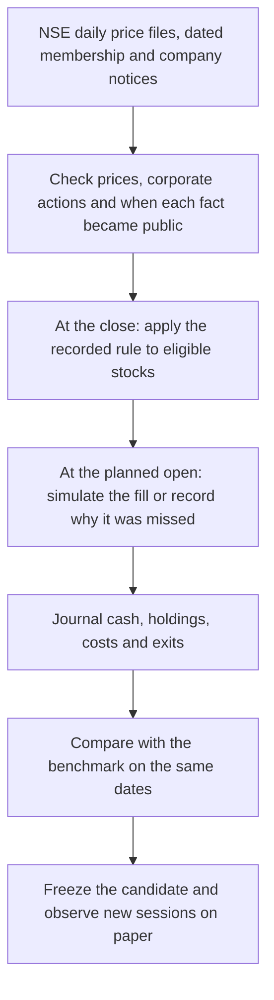
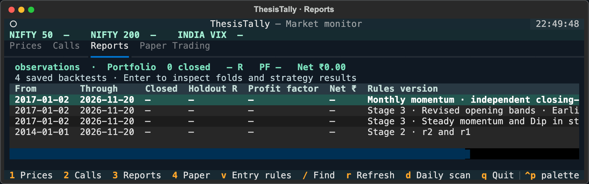
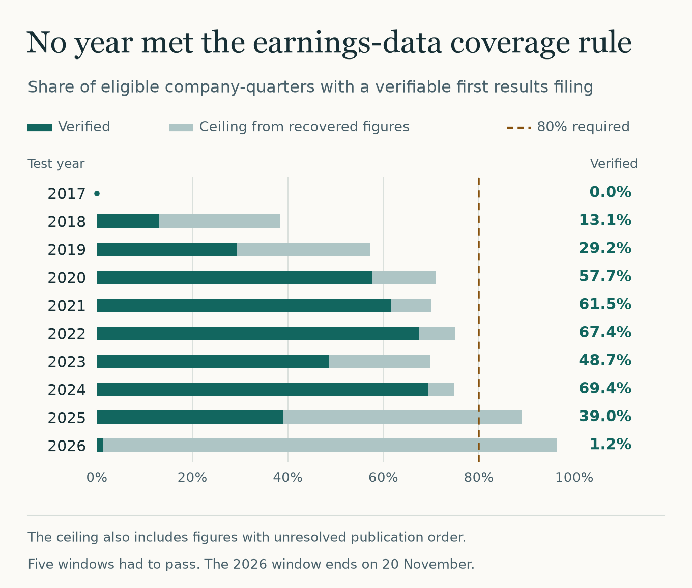

# ThesisTally

ThesisTally is a local, open-source terminal for testing swing-trading and momentum ideas on Indian equities. Would a rule have been worth following with the Nifty 200 stocks, prices and information available at the time? It records the plan when the signal appears and follows it through a simulated trade.

**Research only. Paper calls only. No broker orders. This is not investment advice.** The strongest historical candidate is still being observed on paper. [Candidate decision](docs/A126_CANDIDATE_REPORT.md) · [Full research diary](docs/RESEARCH_SUMMARY.md)

[Install and open the terminal](#quick-start) · [Experiments in plain English](#experiments-in-plain-english) · [System architecture](#system-architecture)

## Why it exists

| How a backtest can fool you | What ThesisTally does |
| --- | --- |
| Tomorrow's information leaks into today's trade. | It timestamps signals at the close, checks the next tradable open, and tests whether adding future price rows changes an earlier signal. Earnings research uses the exchange publication clock. [Pilot checks](docs/PILOT_REPORT.md) · [Filing-clock audit](docs/STRATEGY_D2_XBRL_COVERAGE.md) |
| Today's index members make the past look better. | It rebuilds **point-in-time** membership, meaning the stocks actually in the index on each date. Stocks that later merged, left the index or stopped trading stay in the history. [Membership evidence and gaps](docs/DATA_GAPS.md) |
| Small paper profits disappear in a real account. | It charges trading costs, applies adverse execution prices and limits available capital. For monthly momentum it also compares capital-gains tax with holding the index over the same dates. [Execution report](docs/PILOT_R2_REPORT.md) · [Tax comparison](docs/A_MOMENTUM_TAX.md) |
| A winning chart gets picked after seeing the results. | Rules and pass criteria are written down first. Failed tests stay in the register. An independent reviewer checks each stage. New forward paper sessions provide the final test. [Preregistration](docs/PREREGISTRATION.md) · [Experiment register](docs/EXPERIMENTS.md) |

## Key findings at a glance

An **R-multiple** divides a trade's rupee profit or loss by its original rupees at risk between the entry and stop. A mean of +0.25R means earning a quarter of the initial risk per trade on average. **CAGR** is the compound annual growth rate. The **Nifty 200 TRI**, or total-return index, includes reinvested dividends. **Drawdown** measures the fall from an earlier portfolio peak. [Swing-trade measures](docs/BASELINE_REPORT.md) · [Momentum benchmark](docs/A126_CANDIDATE_REPORT.md)

The main annual tests span 2017 through **20 November 2026**. The last year is partial. In paired swing results, the **funded** figure comes first and **equal risk** second. The funded paper account has one pool of simulated cash. The equal-risk book gives each valid call a separate risk budget, so overlapping trades can reveal whether the setup itself worked. A *counted* close has a full observation horizon in a window that passed the study's sample and data checks. Monthly buys and sells are individual executions and include weight adjustments. [Baseline](docs/BASELINE_REPORT.md) · [Registered tests](docs/PREREGISTRATION.md) · [Discovery validation](docs/DISCOVERY.md)

**XIRR** is an annualised investor return that accounts for the dates cash leaves or enters the account, including tax payments. A dash means a return could not be measured. [Tax method](docs/A_MOMENTUM_TAX.md)

| Strategy | Idea | Test years | Trades or fills | After trading costs (and after tax where measured) | Verdict and evidence |
| --- | --- | --- | --- | --- | --- |
| Early ranking comparison | Rank eligible calls by relative strength or by a LightGBM model trained on earlier trades | One comparable historical window | 9 / 10 closes, original / model | −0.140R / −0.618R | Untestable at the required sample size. [Ranking evaluation](docs/current-design.md#historical-evaluation-and-model-qualification) |
| Trend pullback r1 | Buy a pullback in an established uptrend | 2017–26 | 77 / 556 counted | −0.271R / −0.166R | No edge, retired. [Baseline](docs/BASELINE_REPORT.md) |
| Trend pullback r2 | Same setup with fill-based targets and a chase limit | 2017–26 | 152 / 2,847 counted | −0.016R / −0.075R | No edge, retired. [Baseline](docs/BASELINE_REPORT.md) |
| Volatility breakout r1 | Buy a breakout after price ranges contract | 2017–26 | 0 / 54 counted | — / +0.098R | No edge, retired. [Baseline](docs/BASELINE_REPORT.md) |
| Volatility breakout r2 | Same breakout under revised entry rules | 2017–26 | 0 / 314 counted | — / −0.133R | No edge, retired. [Baseline](docs/BASELINE_REPORT.md) |
| 52-week-high momentum r1 and r2 | Buy strength near a yearly high with volume confirmation | 2017–26 | 0 funded or equal-risk closes in either revision | Unmeasured | No edge, retired. [Baseline and signal funnel](docs/BASELINE_REPORT.md) |
| Steady momentum A126 | Hold a monthly basket of smoothly rising stocks using 126 closes | 2017–26 | 616 buys, 657 sells | 19.00% annualised vs 14.28% TRI. After-tax XIRR 13.62% vs 13.34% | Candidate. Won 5 of 10 windows, needed 7. [Results](docs/A126_CANDIDATE_REPORT.md) · [Tax](docs/A_MOMENTUM_TAX.md) · [Fills](data/stage3/close-verification/runs/a79daa45cf9271df5dbf/ebacb99feeda3ad7d4c0/results.json) |
| Steady momentum A252 | Use 252 closes to rank the monthly basket | 2017–26 | 585 buys, 583 sells | 14.43% annualised vs 14.28% TRI. After-tax XIRR 11.51% vs 13.34% | Below hurdle. Won 5 of 10 windows. [Results](docs/A126_CANDIDATE_REPORT.md) · [Tax](docs/A_MOMENTUM_TAX.md) · [Fills](data/stage3/close-verification/runs/a79daa45cf9271df5dbf/ebacb99feeda3ad7d4c0/results.json) |
| Dip in steady risers B10 | Buy a short dip in a smooth uptrend when two-session relative strength index (RSI) falls below 10 | 2017–26 | 172 / 1,175 counted | +0.026R / +0.042R | Below hurdle, parked. [Results](docs/STAGE3_ENTRY_REPORT.md) · [Decision](docs/EXPERIMENTS.md) |
| Dip in steady risers B5 | Require RSI below 5 for a deeper dip | 2017–26 | 146 / 515 counted | +0.158R / +0.072R | Below hurdle, parked. [Results](docs/STAGE3_ENTRY_REPORT.md) · [Decision](docs/EXPERIMENTS.md) |
| Range Bouncers C, midpoint | Buy near the bottom of a repeated trading range and exit at its midpoint | 2017–26 | 25 / 48 mature, 0 counted | +0.142R / +0.446R on observed mature trades | Untestable at required sample size. [Range report](docs/RANGE_BOUNCERS_REPORT.md) |
| Range Bouncers C, top fifth | Hold the same entries until the top fifth of the original range | 2017–26 | Same 25 / 48 mature, 0 counted | +0.261R / +0.524R on observed mature trades | Untestable at required sample size. [Range report](docs/RANGE_BOUNCERS_REPORT.md) |
| Filter · pullback, stop under 5% | Choose pullbacks with tighter stops | 2021–26 | 2,050 equal-risk counted | −0.112R | Below hurdle. [Discovery](docs/DISCOVERY.md) |
| Filter · pullback, breadth above 60% | Require broad market participation | 2021–26 | 2,377 equal-risk counted | −0.078R | Below hurdle. [Discovery](docs/DISCOVERY.md) |
| Filter · B10, stop 5% to below 7% | Select medium-width stops | 2021–26 | 189 equal-risk counted | −0.038R | Below hurdle. [Discovery](docs/DISCOVERY.md) |
| Filter · B10, lowest ranking fifth | Select the weakest fifth of the top 40 ranked stocks | 2021–26 | 156 equal-risk counted | +0.048R | Below hurdle. [Discovery](docs/DISCOVERY.md) |
| Filter · B10, best prior stocks | Select the strongest fifth by prior three-year trade performance | 2021–26 | 0 counted | Unmeasured | Untestable at required sample size. [Discovery](docs/DISCOVERY.md) |
| Filter · B5, lowest ranking fifth | Select the weakest fifth of the top 40 | 2021–26 | 71 equal-risk counted | +0.111R | Below hurdle. [Discovery](docs/DISCOVERY.md) |
| Filter · B5, stop 5% to below 7% | Select medium-width stops | 2021–26 | 47 equal-risk counted | +0.042R | Untestable for the relative test. One adequate comparison. [Discovery](docs/DISCOVERY.md) |
| Post-earnings momentum D40 and D20 | Buy a strong earnings surprise with a positive relative price reaction and exit after 40 or 20 sessions | 2017–26 | No eligible trade sample | Unmeasured in both books | Untestable. No test year reached the filing-coverage requirement. [Results](docs/RESULTS_D_REPORT.md) |
| D2 coverage check for D40 and D20 | Use the first published structured results filing to date the same signals | 2017–26 | No performance replay | Unmeasured | Untestable, parked. Zero verified windows. Five were required. [Final coverage](docs/STRATEGY_D2_XBRL_COVERAGE.md) |

### Experiments in plain English

We started by testing whether the simulator could account for what a shareholder actually owned. Then we tested the trading ideas. A simulated account that stayed in cash because an old price band was missing said little about momentum. Allowing a flagged fill at an unknown band and verifying the disputed closing prices let both monthly portfolios complete all ten windows under their original rules. [Pilot and matched-entry test](docs/PILOT_R2_REPORT.md) · [Opening-band correction](docs/STAGE3_ENTRY_REVISION.md) · [Completed-window study](docs/A126_CANDIDATE_REPORT.md)

- **Daily price patterns.** In the primary r2 equal-risk test, pullbacks and volatility breakouts lost money even before costs. The high-momentum rule produced 41 detections across training and testing and no fills. The formal baseline judged the evidence insufficient. The project later retired all three as “no edge” for deployment. [Baseline](docs/BASELINE_REPORT.md) · [Retirement decision](docs/PREREGISTRATION.md#experiment-budget-and-retirement)
- **Monthly momentum.** A126 beat the index on linked after-cost growth and had a smaller maximum drawdown, 25.64% versus 38.03%. It won only five of ten annual tests. Seven wins were required. In the separate continuous tax comparison its investor return came close to holding the index. [Final momentum review](docs/A126_CANDIDATE_REPORT.md) · [Continuous tax account](docs/A_MOMENTUM_TAX.md)
- **Promising averages can come from very few trades.** Buying dips produced a small positive average below the return hurdle. Range Bouncers' positive averages came from the same 48 independent entries under two exit rules. None of its eligible years supplied enough trades to count. [Dip results](docs/STAGE3_ENTRY_REPORT.md) · [Range persistence test](docs/RANGE_BOUNCERS_REPORT.md)
- **Could a narrower filter rescue the daily strategies?** We used earlier years to propose seven filters, including buying dips only in certain ranks or with certain stop distances. In six later annual windows, the best filter won three comparisons against the unfiltered strategy. Four were required, and none survived the statistical correction for testing the family. [Discovery experiments](docs/DISCOVERY.md) · [Permanent results](data/discovery/families/discovery-v1/validation.json)
- **A filing date is part of the signal.** The NSE-only check appeared to give earnings momentum two usable years. Checking the earliest structured filing across both NSE and BSE verified zero at the required coverage. The earnings strategy's return is unmeasured. [Superseding D2 audit](docs/STRATEGY_D2_XBRL_COVERAGE.md)


Each bar represents a separately funded annual test. The completed-window report supersedes the earlier opening-band results for A. The revised opening-band report remains the results source for B. [Final A windows](docs/A126_CANDIDATE_REPORT.md) · [Revised B windows](docs/STAGE3_ENTRY_REPORT.md) · [Record of superseded tests](docs/EXPERIMENTS.md)


The tax chart follows one continuous investment and illustrates selling the remaining holdings at the end. The table above quotes the report's actual-sales investor returns, which mark remaining holdings at their closing prices. The linked annual tests restart with fresh cash each year. To see the effect of tax alone, compare rows within the continuous account. [Tax treatments and cash flows](docs/A_MOMENTUM_TAX.md)

## How the research works

### System architecture


The terminal reads two different kinds of records. The daily journal answers “What happened to this call?” with its plan, fills, cash movements and exits. A historical report answers “Did the rule work?” over fixed test dates, with its inputs and comparison recorded. The frozen monthly account has its own ledger so a discovery experiment cannot change its forward paper record. [Component and storage guide](docs/current-design.md) · [Research isolation](docs/DISCOVERY.md) · [Filing archive](docs/D2_FORWARD_COLLECTION.md)

### From an exchange record to a paper trade



**Prices and membership.** The primary price record is the National Stock Exchange of India (NSE) *bhavcopy*, the exchange's final daily price and volume file. Kite daily history supplies an independent cross-check where available. The dated membership file tracks securities by ISIN, the identifier for a particular issue of shares. Symbols can change, and a split can change the ISIN itself. The backtester checks the exchange calendar, validates each day's open, high, low and close, and reconciles membership to published index totals. A missing surveillance flag is stored as unknown. A move over 20% without an explaining corporate action is quarantined until dated evidence supports it. A quarantine discovered at the close cannot cancel that morning's trade. [Historical inputs](docs/DATA_GAPS.md) · [Membership file](data/universes/nifty200_membership.csv) · [Price verification](docs/HELD_CLOSE_VERIFICATION.md)

**Shareholder events.** Splits translate share counts and price levels into the new units. A compulsory merger or conversion carries the position to the successor at the published ratio. Orders freeze during suspension. If a stop or time exit becomes due, the simulator sells at the first tradable successor open with slippage. It values a fractional entitlement at the issuer's published proceeds, or flags the successor's first close as a fallback. For rights issues the holder keeps the shares, declines to subscribe and receives zero cash for the rights. The price history and active levels reflect the dilution. A cash delisting uses the published exit price or a flagged last-traded price. Each event retains its sources. [Pilot conversion](docs/PILOT_REPORT.md) · [Rights and exit repairs](docs/STAGE3_PLUMBING.md)

**Fills and costs.** A fill is a simulated execution. The swing engine normally buys at the following open and charges five basis points of adverse slippage per side, or 0.05%. The study assumes zero separate delivery brokerage. It includes securities transaction tax, exchange and regulatory charges, investor protection charges, GST, buy-side stamp duty and the sell-side depository charge. In r2 the *max-chase* rule skips an open more than half an ATR above the signal close. ATR is the average true range, a measure of recent daily price movement that includes gaps. The original pattern stop must be 3–10% from the fill and within 2.5 times the 14-session ATR. The target is recalculated from the actual fill. A closing stop queues a sale at the next tradable open. If a daily bar touches both the stop and target, the stop takes priority and the partial target sale is suppressed. A verified upper-band lock can block entry. An unknown band allows a flagged fill. B and D specify their own three-ATR stops. Monthly A uses its own rebalance exits. [R2 mechanics](docs/PILOT_R2_REPORT.md) · [Execution revision](docs/STAGE3_ENTRY_REVISION.md) · [Strategy-specific rules](docs/PREREGISTRATION.md)

**Portfolio controls.** The funded r2 swing account starts with ₹10 lakh. It normally risks 0.5% of equity per trade, with up to eight positions, two per sector and 4% total open risk. The *regime gate* tests broad market conditions. The Nifty 50 must be above its 200-session exponential moving average. At least half the eligible stocks must be above their 50-session exponential average, and India VIX, the market volatility index, must be at or below 22. At a 6% drawdown, new risk halves. At 10% it pauses. Ten consecutive passing market closes restart funding at half risk. A new equity high restores full risk. The equal-risk comparison assigns up to ₹5,000 per valid trade independently of portfolio capacity. [Portfolio mechanics](docs/PILOT_R2_REPORT.md) · [Gate and risk rules](docs/PREREGISTRATION.md) · [Control settings](src/thesistally/revisions/r2.yaml)

### What counts as evidence

A **walk-forward** test moves chronologically. Three earlier years provide history, then the rule is evaluated in the following year. The account starts afresh in each annual test. A **holdout** is data set aside before choosing a rule. The early historical holdouts remain in the diary. The final holdout is now prospective: only new sessions after a rule freeze count towards its forward record. [Baseline design](docs/BASELINE_REPORT.md) · [Change of holdout](docs/PILOT_R2_REPORT.md) · [Frozen candidate](docs/A126_CANDIDATE_REPORT.md)

| Test | What it must clear |
| --- | --- |
| Swing strategies | At least 100 counted mature closed trades and at least 20 per counted window. Mean after-cost R above +0.25. The lower end of the 90% confidence interval must be above zero. Net rupee gains divided by absolute net rupee losses must exceed 1.4. At least two-thirds of the relevant test windows must have a positive mean under the registered voting rule. Trades on a common signal date are grouped when estimating uncertainty. [Baseline](docs/BASELINE_REPORT.md) · [Registered qualification](docs/PREREGISTRATION.md) |
| Monthly A | Beat the same-date TRI after costs in at least seven of ten windows, beat its linked CAGR and keep maximum drawdown within 1.2 times the index drawdown. All scheduled windows must be accounted for. [Final A report](docs/A126_CANDIDATE_REPORT.md) |
| Data coverage | In studies using the entry-coverage rule, more than 10% of intended entries blocked by missing data makes a window ineligible. D needs verified first-reported figures for at least 80% of eligible stock-quarters per window. D2 required at least five such windows before running either exit horizon. [Entry revision](docs/STAGE3_ENTRY_REVISION.md) · [D2 coverage](docs/STRATEGY_D2_XBRL_COVERAGE.md) |

Preregistration fixes the hypothesis, its rules, comparison and experiment budget before performance is examined. A and B each had one primary definition and one sensitivity. A data repair repeats the same definitions and identifies the report it supersedes. The discovery engine corrects for the number of ideas tested together. Each stage records independent review and fixes. Frozen input, configuration and code fingerprints let contributors rerun a given source edition and compare its output bytes. The final D2 audit reproduced all three coverage tables from the saved sources. A fresh exchange download can differ from that archived edition. [Experiment register](docs/EXPERIMENTS.md) · [Review history](docs/RESEARCH_LOG.md) · [D2 evidence seal](data/fundamentals/d2-bse/sealed.json)

## What's running now

- **A126 forward paper account.** The frozen candidate ranks stocks at month-end, holds up to 15, and models the rebalance at the next tradable open. It marks the account on subsequent completed sessions. The dedicated macOS service checks at login and every ten minutes while awake. Use `radar report --since-freeze` for its measured return, exposure, drawdown and turnover against the TRI. Strategy B's two variants are parked. [Frozen candidate and operating rules](docs/A126_CANDIDATE_REPORT.md) · [Operations](docs/operations.md) · [B decision](docs/EXPERIMENTS.md)
- **Daily calls and paper journal.** With the terminal or scheduler running, the scan checks for the NSE final from 15:45 IST on exchange days and advances the journal once for that session. It tracks pending entries, open holdings, exits and trading costs. The three retired detectors issue no new forward calls. A user's Taken or Skipped annotation preserves the simulated outcome for comparison. [Terminal and scheduler](docs/operations.md) · [Retirement decision](docs/PREREGISTRATION.md#experiment-budget-and-retirement)
- **Forward results filings.** A separate collector polls NSE and BSE every 30 minutes, including weekends. It saves original XBRL (machine-readable financial statements), announcements, their publication times and their retrieval times. It retries missed dates after sleep. Its first documented live collection saved BCSSL's filing less than four minutes after NSE published it. [Collector](docs/D2_FORWARD_COLLECTION.md) · [First live receipt](data/fundamentals/d2-forward/first-live-filing-20261123.json)

## Strategy discovery engine

An exploratory slice asks, for example, how past pullbacks performed in a broad market rally. Looking through many slices makes some look profitable by chance. Only prior information may select a slice at the start of a validation window. A filter must qualify on its own, beat the unfiltered book in at least two-thirds of its validation windows, and survive the Benjamini–Hochberg correction, which controls false discoveries across the family of tests. None of the seven registered filters passed. Failed hypotheses and their evidence remain public. [Method and results](docs/DISCOVERY.md) · [Family validation record](data/discovery/families/discovery-v1/validation.json)

| Command | What it does |
| --- | --- |
| `radar discover pullback` | Shows exploratory trade slices and candidate hypothesis cards. The built-in dip samples are `b10` and `b5`. |
| `radar validate pullback-b71cffc7` | Runs the preregistered rolling comparison and corrects for the entire family before returning the named card. |
| `radar register` | Lists the append-only record of proposals, decisions and evidence. Earlier entries stay visible. |

To reproduce the original registered family, run these in a **linked Git worktree of the original research checkout**. From a clone of the revision containing the discovery engine, use `git worktree add --detach ../thesistally-discovery HEAD`, enter that directory and run `uv sync --frozen`. Prefix the commands with `uv run --frozen`. The research worker confines writes to its own data tree. Linux requires working `bubblewrap`; macOS uses its sandbox. Rebuilding historical samples requires the corresponding source archive. [Discovery usage and archive layout](docs/DISCOVERY.md)

## Quick start

**What comes with the public checkout.** You can install the terminal, open the saved reports and read every recorded experiment decision. The historical reports cite commit IDs from the original research checkout. Running the frozen A126 account, rebuilding the original discovery register or replaying Strategy D requires that checkout with its original Git objects. Full replays also need the certified market archive. For a public view of the discovery results, open the [saved validation register](data/discovery/families/discovery-v1/validation.json).

Some original AMFI workbooks and BSE attachments contain their creators' workstation details. The public snapshot omits those files and retains their source receipts for independent verification. [AMFI sources and checksums](data/discovery/sources/amfi/manifest.json) · [BSE filing evidence](docs/FUNDAMENTALS_COVERAGE.md)

### 1. Get the code and install the dependencies

You need Git, Python 3.11 or newer, and `uv`. In GitHub's **Code → HTTPS** menu, copy the repository URL and substitute it for `REPOSITORY_URL` below. If you already have the checkout, start at `uv sync --frozen` in its directory. You can also read the published reports directly as Markdown. [Project requirements](pyproject.toml) · [Install uv](https://docs.astral.sh/uv/getting-started/installation/)

```sh
git clone REPOSITORY_URL thesistally
cd thesistally
uv sync --frozen
uv run --frozen radar report --help
```

Look for `--since-freeze` in the report command's help. You can reach this screen before connecting a broker account.


### 2. Open the terminal

```sh
uv run --frozen radar
```

The four tabs are **Prices**, **Calls**, **Reports** and **Paper Trading**. Press **3** for Reports, select a row and press **Enter** to open it. Press **Esc** to go back or **Q** to quit. [Terminal controls](docs/current-design.md)



Try the **Monthly momentum** row first. Its report shows how often each variant beat the index, how far it fell from its peak and why it missed the qualification threshold. The screenshot above uses the saved reports with the live price feed disconnected. [View the opened report](docs/figures/terminal-report-detail.png) · [Read the underlying study](docs/A126_CANDIDATE_REPORT.md)

### 3. Connect live market data if you need it

For live prices and Kite historical checks, use your own Zerodha account, a Kite Connect app with market-data access, and a fresh access token from the daily login. Zerodha lists its live and historical Connect data plan at **₹500 per month**. The exchange-only A126 collector and the results-filing collector can run without a Kite login. [Operations](docs/operations.md) · [Project cost assumption](docs/project-plan.md) · [Official Kite pricing](https://zerodha.com/products/api/)

For the Kite feed, create a local, Git-ignored `.env` and replace the placeholders on your machine.

```dotenv
KITE_API_KEY=replace_with_your_app_key
KITE_ACCESS_TOKEN=replace_with_your_daily_access_token
```

```sh
uv run --frozen --env-file .env radar session
uv run --frozen --env-file .env radar
```

| Command | What it does |
| --- | --- |
| `radar daily` | Collects the published exchange final and advances the daily paper journal. |
| `radar run` | Starts the unattended exchange-day scheduler, optional private notifications and backups. |
| `radar calls --open` | Lists open or pending calls. Use `radar call ID` to inspect a call's history. |
| `radar forward-update` | Catches a configured frozen A126 account up to available completed sessions. |
| `radar report --since-freeze` | Reports observed A126 results against the same-date TRI. |
| `uv run --frozen python -m thesistally.results_forward --status` | Reads the installed forward filing archive and shows saved filings and outstanding errors. |

Use `uv run --frozen --env-file .env` before a `radar` command when it needs variables from that file. The ordinary data root is `data/` and can be set with `RADAR_DATA`. The daily journal is `data/journal.sqlite`. Price snapshots use `data/sessions/`. Historical reports use `data/backtests/`. Discovery evidence uses `data/discovery/`. A126 stores its journal under `forward/<freeze-tag>/journal.sqlite` within its data root. The dedicated filing service uses `data/fundamentals/forward/filings.sqlite3` relative to its own service directory. To install the independent filing collector on macOS, run `uv run --frozen python scripts/install_results_filings.py`. A fresh clone includes selected research evidence. Full market replays and the dedicated A126 installation require their certified market archive and starting snapshot. [Operations](docs/operations.md) · [A126 installer](scripts/install_a126_agent.py) · [Filing collector setup](scripts/install_results_filings.py)

## Limitations

- **Missing market evidence.** Older surveillance flags and opening price bands are incomplete. Unknown surveillance can exclude a setup. An unknown band permits a flagged simulated fill under the revised convention. Some large price moves still lack sufficient corroboration. An unresolved held price can stop valuation for the whole account. [Data gaps](docs/DATA_GAPS.md) · [Held-close evidence](docs/HELD_CLOSE_VERIFICATION.md)
- **Daily candles hide the order of events.** An open, high, low and close cannot show the intraday path, queue position or quantity available at a price. A fixed slippage assumption and conservative tie handling cannot replicate a real fill. [Pilot execution checks](docs/PILOT_REPORT.md) · [R2 mechanics](docs/PILOT_R2_REPORT.md)
- **Taxes depend on the investor.** The A comparison models a resident individual, year-specific listed-equity capital-gains rules, oldest shares sold first, and tax paid from separate cash. It excludes personal deductions, surcharge and dividend income tax. Its index proxy has no fund fee or tracking error and is sold once at the end. Other strategies have no published after-tax result. [Tax assumptions](docs/A_MOMENTUM_TAX.md)
- **Ten scheduled windows do not mean ten usable observations of an edge.** A completed all ten but won only five. Some B books had only three to five coverage-eligible years. C's selected calls were too infrequent. Earlier BSE filings could often be identified but their original four quarterly figures could not be verified at publication. That left D2 without a qualifying window. [A windows](docs/A126_CANDIDATE_REPORT.md) · [B coverage](docs/STAGE3_ENTRY_REPORT.md) · [C sample](docs/RANGE_BOUNCERS_REPORT.md) · [D2 audit](docs/STRATEGY_D2_XBRL_COVERAGE.md)



A missing original is a limit on what can be tested. It does not establish that a company failed to file. [Verified annual counts and upper bounds](docs/STRATEGY_D2_XBRL_COVERAGE.md)

## Roadmap

- Accumulate new A126 paper observations with its rule revision frozen. A lower-turnover momentum variant and sector rotation are **proposals**. Each would need a separate preregistration and account before testing. [Current candidate](docs/A126_CANDIDATE_REPORT.md)
- Keep collecting quarterly filings and their original timestamps. Revisit results-based forward testing once there is enough earnings history and coverage to calculate surprises prospectively. [Results decision](docs/STRATEGY_D2_XBRL_COVERAGE.md)
- Keep AI research advisory in the default setup. The optional TradingAgents workflow already records dated reports using a signed-in Codex CLI. Private Telegram alerts and Taken/Skip callbacks are also implemented for configured users. Neither feature establishes a trading edge. [Research and notification operations](docs/operations.md)

## Contributing

1. Start with a hypothesis, the eligible universe, data clock, rules, costs, benchmark, test windows and pass criteria. Register them before inspecting test outcomes. Keep rejected cards and identify any superseded evidence. [Preregistration](docs/PREREGISTRATION.md) · [Experiment register](docs/EXPERIMENTS.md)
2. To add a discovery strategy, expose a class through the Python entry-point group `thesistally.discovery_strategies`. Its `load(archive)` method returns an equal-risk trade table and dated window metadata. Supply the ISIN, signal and settlement dates, observation horizon, net result, coverage, and source hashes. [Plugin contract and example](docs/DISCOVERY.md#adding-a-strategy-plugin)
3. Use the shared detector and execution logic for scans and replay. Preserve the frozen paper account and append-only journals. Add tests for future-data leakage, corporate actions, fills and idempotency where the change can affect them. Ask an independent reviewer to trace the inputs and a sample of executions through to the reported result. [Research log](docs/RESEARCH_LOG.md) · [Isolation tests](tests/test_discovery_isolation.py)
4. Follow the repository's Python style and Ruff settings. Run `uv run --frozen ruff check` on changed Python files and `uv run --frozen --all-extras pytest -q` for the regression suite. Document the data edition and the reason for each rule change. [Project settings](pyproject.toml) · [CI workflow](.github/workflows/research.yml)

## Disclaimer and compliance

Run your own copy for private research. Paper calls are simulated observations. Do not publish them as live recommendations in public channels. The Securities and Exchange Board of India (SEBI) Research Analyst rules cover research services and can impose registration and disclosure obligations when recommendations are offered or shared in public media. ThesisTally provides no investment advice and sends no broker orders. [SEBI's research analyst FAQ](https://www.sebi.gov.in/sebi_data/faqfiles/jul-2025/1753269723942.pdf)

Nifty, NSE, Kite and Zerodha are trademarks of their respective owners. ThesisTally is independent and is not affiliated with them.

## License

ThesisTally's source code is available under the [MIT License](LICENSE).
