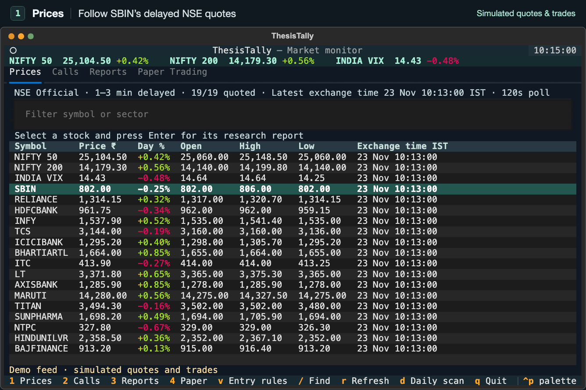
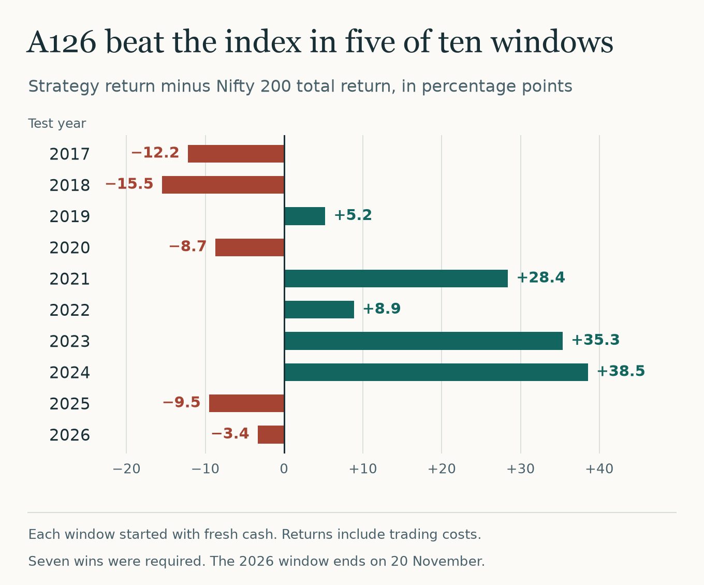
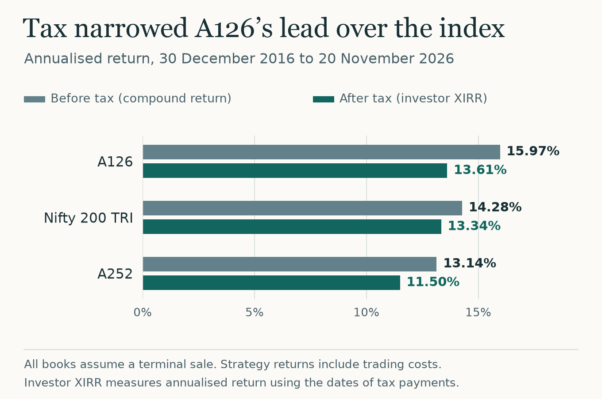
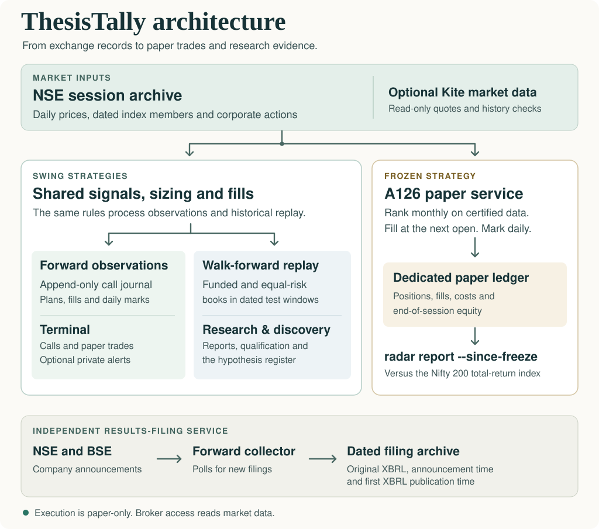
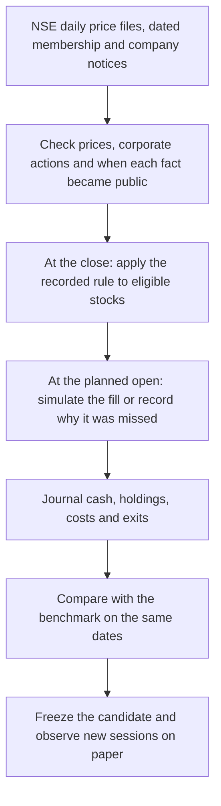
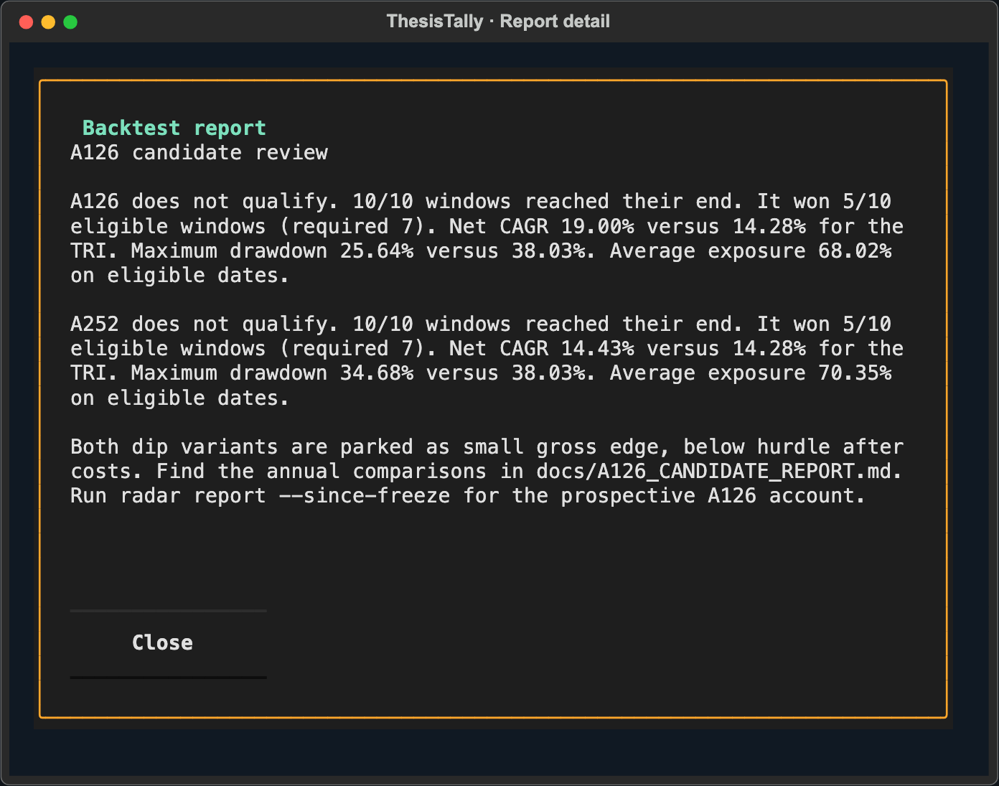

# ThesisTally

ThesisTally tests trading ideas on the Nifty 200 stocks that belonged to the index at the time. Its local terminal tracks paper trades after costs. **Paper trading only. No broker orders. No investment advice.**

[](docs/figures/terminal-tour.gif)

The tour uses example quotes, stock research and paper trades. The Reports tab shows the published monthly momentum study. [View a still screenshot](docs/figures/terminal-prices.png)

[Quick start](#quick-start) · [Price connections](docs/operations.md#terminal-price-sources) · [Architecture](#architecture) · [Full research diary](docs/RESEARCH_SUMMARY.md)

## What the experiments found

### Monthly momentum beat the index in five of ten windows

A126 buys stocks that rose steadily over 126 sessions. Across the linked annual tests, it grew **19.00% a year after costs**, versus **14.28%** for the Nifty 200 including dividends. Its worst peak-to-trough fall was **25.64%**, versus **38.03%**. It needed seven wins to qualify and remains a paper candidate. [Annual results](docs/A126_CANDIDATE_REPORT.md)



### After tax, A126 came close to holding the index

A separate test followed one investor through the tax years. Selling all holdings at the end gave annualised after-tax returns of **13.61% for A126**, **13.34% for the index** and **11.50% for A252**, the 252-session variant. [Tax assumptions and results](docs/A_MOMENTUM_TAX.md)



### Daily swing strategies

These results give each trade the same risk budget. **1R** is the amount initially risked.

| Idea | What we found |
| --- | --- |
| Pullbacks and volatility breakouts | After costs, 2,847 counted pullbacks averaged **−0.075R** and 314 counted breakouts averaged **−0.133R**. Both also lost before costs across all closes. [Baseline](docs/BASELINE_REPORT.md) |
| Buying near a 52-week high | The rule detected 41 setups across training and testing and closed **zero trades**. It was retired alongside pullbacks and breakouts. [Signal funnel](docs/BASELINE_REPORT.md) · [Decision](docs/PREREGISTRATION.md#experiment-budget-and-retirement) |
| Buying dips in rising stocks | The two variants averaged **+0.042R** and **+0.072R** after costs. Both fell short of the **+0.25R** hurdle. [Dip study](docs/STAGE3_ENTRY_REPORT.md) |
| Buying near the bottom of a range | Both exits were tested on the same **48 mature trades**. No eligible year reached the 20 trades required to count. [Range study](docs/RANGE_BOUNCERS_REPORT.md) |
| Filtering past signals | **None of seven** filters passed on later years. The best beat its unfiltered strategy in three of six windows. Four wins were required. [Discovery results](docs/DISCOVERY.md) |

### Earnings signals need better filing history

**Zero of ten** years met the 80% filing-coverage requirement. Five were needed to test earnings surprises. The strategy’s return is unknown. New filings are being collected with their publication times. [Coverage audit](docs/STRATEGY_D2_XBRL_COVERAGE.md) · [Forward collector](docs/D2_FORWARD_COLLECTION.md)


## Architecture

The daily scanner and historical replay share execution rules. The frozen monthly portfolio keeps a separate ledger. [Architecture guide](docs/current-design.md) · [Data gaps](docs/DATA_GAPS.md)



### From an exchange record to a paper trade



## Quick start

Clone the repository, then run these commands with Python 3.11 or newer and uv installed. [Install uv](https://docs.astral.sh/uv/getting-started/installation/)

```sh
uv sync --frozen
uv run --frozen radar
```

In **Prices**, select a stock and press **Enter** to read its saved research. Press **A** to analyze it again. From the shell, `uv run radar research SBIN` opens a fresh SBI report. [Stock report controls](docs/operations.md#stock-reports)

**Where prices come from.** NSE Official supplies free quotes with a 1–3 minute delay. Radar checks every two minutes, or when you press **R**. For five-second polling with a Kite login, run `uv run radar --quote-provider kite`. The daily swing scan uses NSE’s closing files and Kite price history. [Price connections and setup](docs/operations.md#terminal-price-sources)

Press **3** for Reports, select **Monthly momentum**, then press **Enter**. Saved reports also open offline.


| Installation | Opened report |
| --- | --- |
| [](docs/figures/install-terminal.png) | [](docs/figures/terminal-report-detail.png) |

The public checkout includes the terminal and saved studies. Full historical replays and the frozen account require the original research history and certified data archive.

Keep live calls private. Register new strategy rules before testing. [Experiment register](docs/EXPERIMENTS.md) · [Strategy plugin guide](docs/DISCOVERY.md#adding-a-strategy-plugin) · [MIT license](LICENSE)
