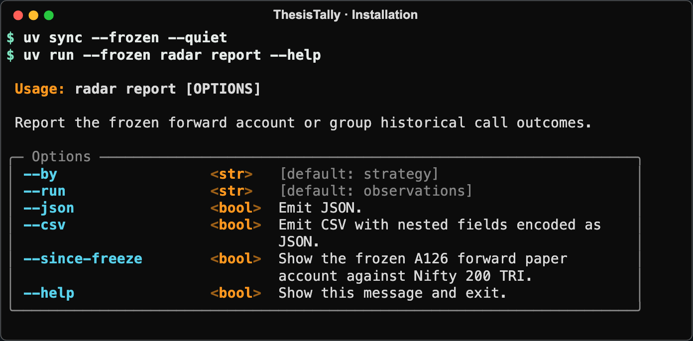

# ThesisTally

ThesisTally is a local terminal for testing trading ideas on Nifty 200 stocks. It uses the stocks that belonged to the index at the time, simulates trades after costs, and keeps a journal of paper calls. **Research only. No broker orders. No investment advice.**


## Quick start

Clone this repository from GitHub’s **Code** menu. From the checkout, run these commands with Python 3.11 or newer and uv installed. [Install uv](https://docs.astral.sh/uv/getting-started/installation/)

```sh
uv sync --frozen
uv run --frozen radar
```

Press **3** for Reports, select **Monthly momentum**, then press **Enter**. The saved studies open without broker credentials. For live quotes, connect your own Kite account. [Setup and daily operation](docs/operations.md)

<details>
<summary>View installation and report screenshots</summary>




</details>

## What the experiments found

| Idea | What happened |
| --- | --- |
| Monthly momentum (A126) | Beat the Nifty 200 total-return index, which includes dividends, in **5 of 10** annual tests. It needed **7** to qualify. It remains a forward paper candidate. [Momentum study](docs/A126_CANDIDATE_REPORT.md) · [After-tax comparison](docs/A_MOMENTUM_TAX.md) |
| Daily price patterns | Pullbacks and volatility breakouts lost money even before costs when each trade had the same risk budget. The 52-week-high rule produced no completed trades. All three were retired. [Baseline](docs/BASELINE_REPORT.md) · [Retirement decision](docs/PREREGISTRATION.md#experiment-budget-and-retirement) |
| Buying dips and range lows | Dips in rising stocks earned too little after costs. Range Bouncers produced too few trades to judge. [Dip study](docs/STAGE3_ENTRY_REPORT.md) · [Range study](docs/RANGE_BOUNCERS_REPORT.md) |
| Earnings surprises | No test year had enough verified, timestamped filings. The strategy is parked while new filings are collected. [Coverage audit](docs/STRATEGY_D2_XBRL_COVERAGE.md) |

None of the seven follow-up filters passed validation on later years. [Filter results](docs/DISCOVERY.md) · [Full research diary](docs/RESEARCH_SUMMARY.md) · [Experiment register](docs/EXPERIMENTS.md)

## Architecture

Exchange prices, index membership and company filings are dated before the rules see them. The swing simulator and daily scan share execution rules. The frozen monthly momentum account keeps its own ledger. [Architecture guide](docs/current-design.md) · [Data gaps](docs/DATA_GAPS.md)

<details>
<summary>View the architecture diagram</summary>


</details>

The public checkout includes the terminal, code and saved studies. Replaying the original registered studies and running the frozen account require their original Git history and certified data archive.

Keep live calls private. To contribute a strategy, register its rules and pass criteria before testing. [Preregistration](docs/PREREGISTRATION.md) · [Strategy plugin guide](docs/DISCOVERY.md#adding-a-strategy-plugin) · [MIT license](LICENSE)
