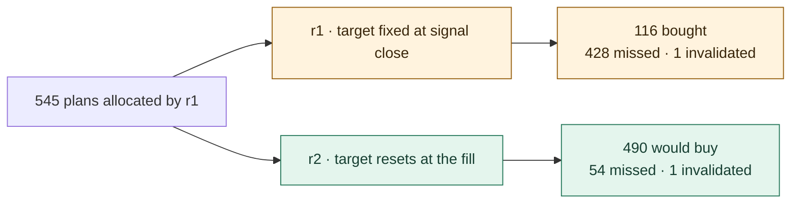
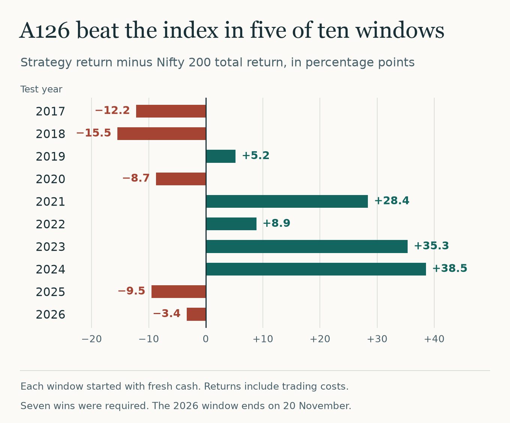
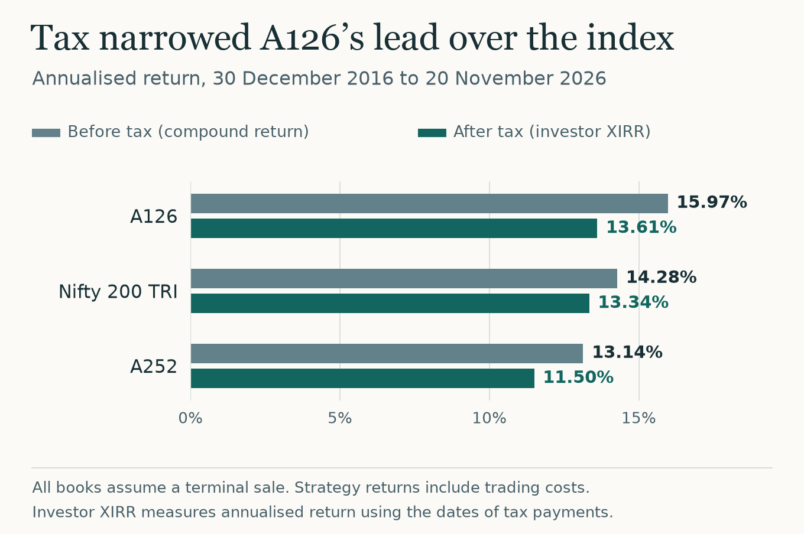
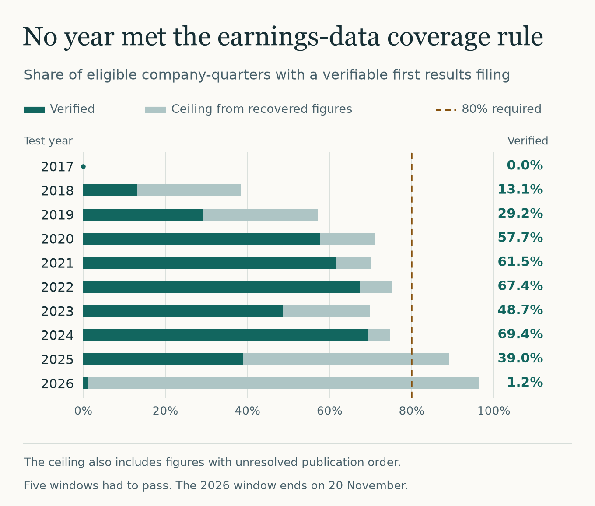

# ThesisTally research diary

The question was whether a rule known before the market opened could earn a repeatable return on Nifty 200 stocks after realistic costs. The strongest monthly momentum candidate earned a higher annualised return than its benchmark, with a smaller drawdown, but missed the required number of winning years. It advanced to forward paper observation. The daily pattern strategies were retired, parked or too thinly sampled. The earnings strategy stopped at a filing-data check before a performance estimate was possible. [Experiment register](EXPERIMENTS.md) · [Momentum decision](A126_CANDIDATE_REPORT.md) · [Final earnings coverage decision](STRATEGY_D2_XBRL_COVERAGE.md)

## Reading the results

**Point-in-time** means using the stock, price, corporate-action and index membership information available on the relevant day. A **holdout** is a period reserved before testing. A **walk-forward test** moves the information cutoff forward and measures the fixed rules on the following period. The annual tests started fresh simulated accounts. The **funded book** applied their cash and portfolio limits. The **equal-risk book** gave each eligible trade a separate risk budget, so overlapping trades could be measured. Its trade returns cannot be added to describe one investable account. [Pilot mechanics](PILOT_R2_REPORT.md) · [Baseline methods](BASELINE_REPORT.md) · [Preregistration](PREREGISTRATION.md)

An **R-multiple** is profit or loss divided by the amount at risk between the filled entry and the original stop. A mean of +0.25R is a quarter of that initial risk per trade. **Drawdown** is the fall from a prior portfolio peak. **CAGR** is the constant annual growth rate that connects starting and ending values. The Nifty 200 **total-return index (TRI)** includes reinvested dividends. An early test used the price index instead. The reports below identify the benchmark, cost treatment and trade population used at each stage. [Pilot report](PILOT_REPORT.md) · [Baseline criteria](BASELINE_REPORT.md) · [Momentum report](A126_CANDIDATE_REPORT.md)

## The early holdouts

An early 35-session diagnostic produced five closed holdout trades and +0.134R per trade. A later sealed study reserved 375 sessions from 21 May 2025 through 20 November 2026. Its 74 closed paper trades averaged −0.270R and lost about ₹69,427 after costs. The project also compared a LightGBM ranking model with the existing relative-strength ranking. Only one window supported the comparison. Relative strength averaged −0.140R on nine closes and the challenger −0.618R on ten. The original ranking stayed in use. [Archived study and ranking results](current-design.md#historical-evaluation-and-model-qualification)

The short 2–20 November 2026 holdout was retired as a final test. The longer sealed study remains historical evidence. Both periods had already been inspected when the pilot began. The project reserved genuinely new sessions after a rule freeze for its final paper test. [Historical evaluation design](historical-research.md) · [Research log](RESEARCH_LOG.md)

The development work also traced where candidates disappeared. The first momentum funnel used average turnover for a preliminary eligibility count. Production used the median. Applying the production definition left 403,907 initially eligible stock-days. Of the 81,031 that survived the relative-strength check, 80,516 failed the base-pattern test. The corrected diagnostic reproduced all 27 final matches. This was a correction to the published count. The trading rule stayed fixed. [Published diagnostic correction](RESEARCH_LOG.md#published-diagnostic-erratum--21-november-2026)

## Stage 1 · Test the ledger before judging a signal

The first pilot replayed 1 January 2024 through 20 November 2026. Its purpose was to reconstruct a ₹10 lakh paper account from the evidence available each day. It checked 718 exchange sessions and 143,814 traded member-day observations. The scanner generated 12,143 plans that passed liquidity, allocated 545 and closed 116 funded trades. The account lost ₹53,590.28 after costs, or −0.158R per closed trade. Without adverse slippage or fees, the same executed quantities already lost ₹23,321.78. These numbers are **pipeline checks only**. [Pilot results, cost decomposition and independent review](PILOT_REPORT.md)

Three historical cases explain why the simulator keeps price changes and the shareholder’s right to trade as separate records. [Pilot corporate-action tests](PILOT_REPORT.md)

- **Tata Motors DVR.** The 7-for-10 compulsory conversion took effect on 1 September 2024. The successor stock was quoted before converted shares reached holders. The first supported sale was the 26 September open. The actual pilot position converted 216 DVR shares to 151 ordinary shares plus cash for a 0.2-share fraction. That cash was ₹218.53, valued at the successor’s first close because no gross fractional proceeds price was available. A separate 209-share test checked a stop breach during the freeze and the deferred sale after credit. Only the actual holding entered pilot performance. [DVR settlement and separate test case](PILOT_REPORT.md)
- **COFORGE.** The five-for-one split changed the tradable identifier on 4 June 2025. The issuer confirmed adjustment of demat balances on 5 June. The simulator held the shares frozen until the 6 June open. Three remaining old shares became 15 new ones, with the original risk preserved. A separate golden test reproduced the actual 20 November 2026 trend-pullback signal from the archived price history. [Shareholder and detector checks](PILOT_REPORT.md)
- **Bharat Dynamics.** On 24 May 2024 the exchange quoted the post-split price under the old security identifier, or ISIN. The new ISIN appeared on 27 May. Joining the two histories on the dated change and applying the two-for-one adjustment once restored 399 full indicator histories. A ticker-only join could have reset the history or applied the adjustment twice. [Bharat Dynamics investigation](PILOT_REPORT.md)

The reviewer also caught an opening-order decision that used a suspect closing price from later that same day. The engine now processes eligible opening orders before acting on close-discovered evidence. Tests append future candles and compare earlier signals, indicators and rankings. If both the stop and target are touched in the same daily candle, the engine gives the stop priority and queues the full exit for the next tradable open. [Pilot review and execution chronology](PILOT_REPORT.md) · [Research log](RESEARCH_LOG.md)

## Revision r2 · Correct missed entries and make the brake releasable

The original r1 rule set its target at twice the planned risk from the signal close. It then demanded the same reward-to-risk ratio after buying at the next open with slippage. Even a modest gap up could reject a trade. On the same 545 original portfolio allocations, r1 admitted 116 entries and r2 admitted 490. R2 retained the pattern stop and recalculated the target from the slipped fill. It capped the opening chase at half a signal-day average true range (ATR), a measure of typical daily price movement. It checked the stop distance again at the fill and stored both planned and filled levels. [Matched-entry diagnostic](PILOT_R2_REPORT.md)

*Both paths start with the same signals. The r2 branch applies the revised entry test to those signals in isolation. Its own funded portfolio followed a different path.* [Source for every branch count](PILOT_R2_REPORT.md)

The r1 drawdown brake briefly released twice in March 2026 when the market gate was closed. After 16 March it stayed paused for the final 170 sessions. R2 resumes at half risk after ten consecutive passing market closes and restores full risk at a new equity high. The pilot exercised three pause-and-resume cycles, each followed by a purchase. It finished at half risk. The r2 funded account closed 161 trades, averaged −0.199R after costs and still held seven positions. No parameter was chosen on those returns. [Brake transitions and funded account](PILOT_R2_REPORT.md)

Three r1 shadow positions had no supportable return. They involved TATACONSUM rights, TVSMOTOR preference shares and a quarantined POLICYBZR close. The report retained each missing outcome. The new equal-risk book also made it possible to distinguish a weak signal from one that the simulated portfolio lacked room to buy. [Shadow cases and independent book](PILOT_R2_REPORT.md)

## Stage 2 · Establish the baseline over the full history

The baseline used 3,190 NSE sessions from 1 January 2014 through 20 November 2026. It ran the existing r1 and r2 rules with three years of prior history and ten subsequent annual test windows. The last year was partial. A closed trade counted toward qualification only when its full opportunity to exit was observable and its window supplied at least 20 mature closes. Qualification required at least 100 counted trades, mean net R above +0.25, a positive lower bound on a 90% confidence interval, cash profit factor above 1.4 and positive mean R in at least two thirds of planned windows. Profit factor divides total net gains in rupees by the absolute total of net losses. [Baseline, sample definitions and thresholds](BASELINE_REPORT.md)

| Strategy | r1 equal risk, counted trades / mean net R | r2 equal risk, counted trades / mean net R | What the baseline found |
| --- | ---: | ---: | --- |
| Trend pullback | 556 / −0.166R | 2,847 / −0.075R | Across all r2 closes, mean gross R was −0.027 before an average 0.075R of costs. [Loss diagnosis](BASELINE_REPORT.md) |
| Volatility breakout | 54 / +0.098R | 314 / −0.133R | Across all r2 closes, mean gross R was −0.081 before an average 0.065R of costs. [Loss diagnosis](BASELINE_REPORT.md) |
| 52-week-high momentum | 0 / — | 0 / — | Only 41 detections in training and testing. The base-low stop exceeded the 2.5 ATR ceiling on 35. Neither revision bought a trade. [Signal funnel](BASELINE_REPORT.md) |

The funded r2 book closed 249 pullbacks and 12 volatility breakouts. Their counted sample sizes were 152 and zero respectively. The archive verified opening bands for 147,270 of 639,334 traded member-day observations. Most measured equal-risk closes came from 2024–2026. No strategy qualified. The formal statistical verdict was “not enough data” because the confidence intervals still allowed competing conclusions or the sample was too small. The project then retired all three as **no edge** for deployment and further tuning. For momentum, zero trades means there is no measured expectancy. [Funded and equal-risk evidence](BASELINE_REPORT.md) · [Retirement decision](PREREGISTRATION.md)

## Stage 3 · Repair the historical execution conventions

Only 37 of 40 baseline book-windows had reached their scheduled end. Two funded accounts stopped at ADANIPORTS on 4 June 2024, when its closing price fell 21.15%. The revised archive released the genuine move after checking the NSE final and dated band evidence. The revised account followed different fills and no longer held the stock that day, so a separate held-position test checked the mark. [Baseline failures](BASELINE_REPORT.md) · [Quarantine and replay evidence](STAGE3_PLUMBING.md)

The r2 account in 2021 had 566 INDHOTEL shares. An unknown lower band delayed its time exit for 75 auctions. A rights issue then left the account without a defensible valuation. The new convention allows a normally slipped opening sale with an unknown band and records the missing field. Holders decline rights subscriptions, receive no entitlement cash and carry the adjusted position. On the new path, INDHOTEL sold from the ₹146 open on 23 July, before the rights issue. All ten r2 funded controls then reached their scheduled end, covering 2,451 sessions. These were repairs to the replay. The original strategy conclusions stayed on record. [INDHOTEL, rights and completed accounts](STAGE3_PLUMBING.md)

## Stage 3 · Register monthly momentum and daily dips

**Steady Momentum (A).** At month-end, rank liquid members by the slope and consistency of their upward price path. The primary uses 126 closes and its sole sensitivity uses 252. The portfolio aims for 15 holdings and allows eligible holdings to stay through rank 30. **Dip in Steady Risers (B).** From the daily top 40 of the primary ranking, buy a short-term dip signalled by the two-session relative strength index, RSI. The primary threshold is below 10 and the tighter version uses below 5. The registered stop was three ATR below entry and the time limit was 15 sessions. [Definitions and qualification criteria](PREREGISTRATION.md)

The first execution produced a misleading momentum result. Unknown historical upper price bands blocked otherwise executable purchases. A126 held only 17.37% in shares on average, and both momentum portfolios spent 2017–2019 entirely in cash. Each beat the index in only one of ten windows. The reported annualised returns of 4.24% and 4.13% describe that superseded execution. [Original Stage 3 report](STAGE3_REPORT.md) · [Supersession record](EXPERIMENTS.md)

### Re-run after fixing the opening-band rule

The revised convention permits a normally slipped purchase when the band is unknown, records the uncertainty, and still blocks a verified upper-band lock. A window is ineligible when missing data blocks **more than 10%** of planned purchases. In the first complete set of rerun outputs, closing-price gaps still interrupted three annual accounts per A setting. A126 and A252 each won four of seven completed windows, with five wins required. A126 exposure rose to 70.61% across observed sessions. The later closing-price study supersedes those incomplete A results. [Entry convention](STAGE3_ENTRY_REVISION.md) · [Revised results](STAGE3_ENTRY_REPORT.md) · [Final A report](A126_CANDIDATE_REPORT.md)

All 40 B book-windows ran to completion, although missing surveillance records excluded several from qualification. The following are the **counted mature samples** after the coverage and sample-size gates. Both settings showed a small gross edge across observed closes. Neither cleared +0.25R after costs. B10 and B5 were parked. This data-revision rerun added no new strategy experiment. [B samples and losses](STAGE3_ENTRY_REPORT.md) · [Recorded decision](EXPERIMENTS.md)

| B setting | Funded trades / mean net R | Equal-risk trades / mean net R | Coverage-eligible windows, funded / equal risk | Source |
| --- | ---: | ---: | ---: | --- |
| RSI below 10 | 172 / +0.026R | 1,175 / +0.042R | 3 / 5 | [B10 report](STAGE3_ENTRY_REPORT.md) |
| RSI below 5 | 146 / +0.158R | 515 / +0.072R | 4 / 5 | [B5 report](STAGE3_ENTRY_REPORT.md) |

### Complete the momentum windows

The five originally disputed closes matched official NSE cash prices and a separate broker history. Kite agreed exactly on three of those five close pairs. Reopening the affected paths exposed two further ICICIPRULI closes in March 2020, confirmed independently against NSE, Kite and Upstox. Each release first affected the session close. All ten windows then finished under both original definitions. [Seven closing-price decisions](HELD_CLOSE_VERIFICATION.md) · [Final study](A126_CANDIDATE_REPORT.md)

| Final annual-account study | A126 | A252 | Nifty 200 TRI |
| --- | ---: | ---: | ---: |
| Linked CAGR after trading costs | 19.00% | 14.43% | 14.28% |
| Maximum drawdown | 25.64% | 34.68% | 38.03% |
| Average invested exposure | 68.02% | 70.35% | — |
| Windows beating the TRI | 5 of 10 | 5 of 10 | — |
| Fees plus adverse slippage | ₹95,141 | ₹69,681 | — |

Both settings passed the aggregate return and drawdown requirements. Each missed the seven required annual wins. The 126-session primary was frozen as **candidate, under observation** after the 20 November 2026 anchor close. The 252-session version remains a historical comparison. Only subsequent paper sessions count toward the prospective test. [Table source, annual comparisons and freeze](A126_CANDIDATE_REPORT.md) · [Decision register](EXPERIMENTS.md)

### Follow one investor through the tax years

A separate simulation ran one continuous ₹10 lakh account per setting from the 30 December 2016 close through 20 November 2026. It carried individual purchase lots across years and assessed capital gains at historical financial-year rates. The investor paid tax from outside the portfolio. The benchmark proxy held a fund tracking the TRI and sold once at the end. Its model assumes zero fund fees and tracking error. [Tax method and year-by-year ledger](A_MOMENTUM_TAX.md)

On actual sales, continuous pre-tax CAGR was 15.97% for A126 and 13.15% for A252, against 14.28% for the index. **Investor XIRR** is the annualised return that accounts for the dates of deposits, tax payments and ending proceeds. It was **13.62% for A126, 11.51% for A252 and 13.34% for the benchmark**. An illustrative sale of all remaining holdings at the end gave 13.61% and 11.50% for the strategies. A126 roughly matched the benchmark after tax under these assumptions. Comparing 19.00% directly to 13.62% would mix fresh annual accounts with a continuous account. [After-tax results and terminal-sale sensitivity](A_MOMENTUM_TAX.md) · [Annual-account results](A126_CANDIDATE_REPORT.md)

## Range Bouncers · Test whether past bounces persist

The next experiment selected stocks monthly that repeatedly crossed a trading range, then bought the next qualifying oversold signal. The primary target was the midpoint. The only sensitivity moved the target to the start of the top fifth. The control took the same daily signal in other eligible Nifty 200 stocks. Dated GAIL and L&T bonus-share evidence repaired interrupted accounts before the final comparison. [Registered range criteria](PREREGISTRATION.md) · [Range report](RANGE_BOUNCERS_REPORT.md) · [Independent review](range-bouncers-review.json)

Each target had 25 mature funded closes and 48 mature equal-risk closes. Funded means after costs were +0.142R at the midpoint and +0.261R at the top fifth. Equal-risk means were +0.446R and +0.524R. The two targets reused the same entries. None of the seven coverage-eligible windows supplied 20 mature range trades. The historical averages therefore could not qualify either version. [Range outcomes and sample sizes](RANGE_BOUNCERS_REPORT.md) · [Experiment register](EXPERIMENTS.md)

Range stocks reached the midpoint on 7 of 48 observable entries, compared with 330 of 1,832 for the controls. They reached the top-fifth target on 2 of 48, compared with 103 of 1,832. Only 13 range trades fell in the three windows where both groups passed their coverage gate. The direction of the difference varied by year. Persistence remains inconclusive. [Persistence comparison](RANGE_BOUNCERS_REPORT.md) · [Experiment register](EXPERIMENTS.md)

## Discovery · Can a preregistered filter rescue a weak signal?

The discovery engine separated idea generation from validation. Its developers inspected 397 slices from 2017–2020, then registered seven filters before publishing 935 full-history slices. These included stock, sector, size, liquidity, volatility, market conditions and planned stop distance. Overlapping trades can appear in many slices. Their apparent winners are leads for research. All seven filters faced the same six later annual windows, from 2021 through 20 November 2026. [Method, slice counts and annual evidence](DISCOVERY.md) · [Preregistered hypotheses](PREREGISTRATION.md)

| Registered filter | Counted trades | Mean net R | Windows won out of six | Source |
| --- | ---: | ---: | ---: | --- |
| Pullback, stop below 5% | 2,050 | −0.112R | 2 | [Validation](DISCOVERY.md) |
| Pullback, market breadth above 60% | 2,377 | −0.078R | 3 | [Validation](DISCOVERY.md) |
| B10, stop from 5% to below 7% | 189 | −0.038R | 1 | [Validation](DISCOVERY.md) |
| B10, weakest fifth of the top 40 ranks | 156 | +0.048R | 2 | [Validation](DISCOVERY.md) |
| B10, strongest fifth of stocks by prior trade performance | 0 | — | 0 | [Validation](DISCOVERY.md) |
| B5, weakest fifth of the top 40 ranks | 71 | +0.111R | 1 | [Validation](DISCOVERY.md) |
| B5, stop from 5% to below 7% | 47 | +0.042R | 1 | [Validation](DISCOVERY.md) |

No filter earned the required four wins. A Benjamini–Hochberg correction assessed the whole family together to limit false discoveries from trying several ideas. The smallest adjusted p-value was 0.969 against a 0.05 threshold. Under the study’s simulated zero-edge model, 3.35% of families produced at least one corrected statistical discovery by chance. All seven decisions remain in the public register. [Family validation and chance model](DISCOVERY.md) · [Machine-readable results](../data/discovery/families/discovery-v1/validation.json)

## Post-earnings momentum · Establish when the market knew the figures

Strategy D asked whether unusually strong year-over-year earnings-per-share growth followed by a positive price reaction could persist. It used a 40-session holding limit and a single 20-session sensitivity. A test year needed dated first-report revenue, operating profit, net profit and earnings per share for at least 80% of eligible stock-quarters. One stock-quarter means one member company’s quarterly results. Original disclosures and subsequent revisions were kept separately. [Preregistration](PREREGISTRATION.md) · [Results study](RESULTS_D_REPORT.md)

The first study could verify all four figures for **610 of 10,221** eligible stock-quarters from 2014 through 20 November 2026. It verified original earnings per share for 925. Only four announcements had enough same-basis history to calculate an earnings surprise, and two passed the relative price-reaction check. In both cases the issuer was the sole scored announcement in its comparison group. Zero of ten annual windows reached the filing threshold. Neither holding period has an eligible trade count, return or after-tax estimate. [Annual results and signal counts](RESULTS_D_REPORT.md) · [Coverage by stock and year](FUNDAMENTALS_COVERAGE.md) · [Independent audit](RESULTS_D_REVIEW.md)

### D2 · Use the first structured filing as the clock

D2 kept both D trading definitions and used the first official XBRL publication. XBRL is a structured filing format whose tags identify figures, units and reporting periods. The historical replay required at least five annual windows with 80% verified coverage. The earlier **NSE-only** count found two, in 2025 and 2026. A search of newly retrieved BSE catalogues showed that another exchange sometimes named an earlier original. A later file could confirm the number while leaving the earlier publication time unresolved. For Reliance’s March 2025 consolidated result, a catalogue gave an April date but linked to a rendering associated with June. [D2 registration](PREREGISTRATION.md) · [Final cross-exchange coverage report](STRATEGY_D2_XBRL_COVERAGE.md)

The combined NSE/BSE audit **superseded the NSE-only count**. It confirmed **zero of ten** windows. Verified first-edition coverage was 312 of 800 stock-quarters in 2025 and 10 of 801 in 2026 through 20 November. Even granting favorable publication ordering for every uncertain quarter with figures in the recovered archive, only those two years could reach 80%. The retrieval tests sometimes received errors for known-good files. An unavailable attachment leaves that company's original figures and release time unverified. [Final coverage and source limitations](STRATEGY_D2_XBRL_COVERAGE.md) · [Independent numerical audit](../data/fundamentals/review/d2-bse-final-1382fc21f57b.json)

D2 was parked without a historical backtest. The proposed AI pass over PDF-only filings was declined. Forward collection started on 23 November 2026. Its scheduled poll captured BCSSL’s September-quarter filing with NSE’s publication time of 20:03:13 IST and a separate retrieval time of 20:06:49 IST. Keeping the two times and the original bytes gives a future earnings study a verifiable starting point. [Decision receipt](../data/fundamentals/d2-bse/decision.json) · [Forward filing receipt](../data/fundamentals/d2-forward/first-live-filing-20261123.json)
