# ThesisTally architecture

Design snapshot · 21 November 2026 · Latest completed session 20 November 2026

The current execution revision is r2. The 718-session mechanics report documents its funded and independent books, entry rules and drawdown transitions. [R2 pilot](PILOT_R2_REPORT.md)

ThesisTally is a local research terminal for long swing trades in the Nifty 200. It answers three questions in the same window. **What matched a rule at the close? What would our paper account actually have traded? What did the AI think before the outcome was known?** Each answer has its own record and time of observation.

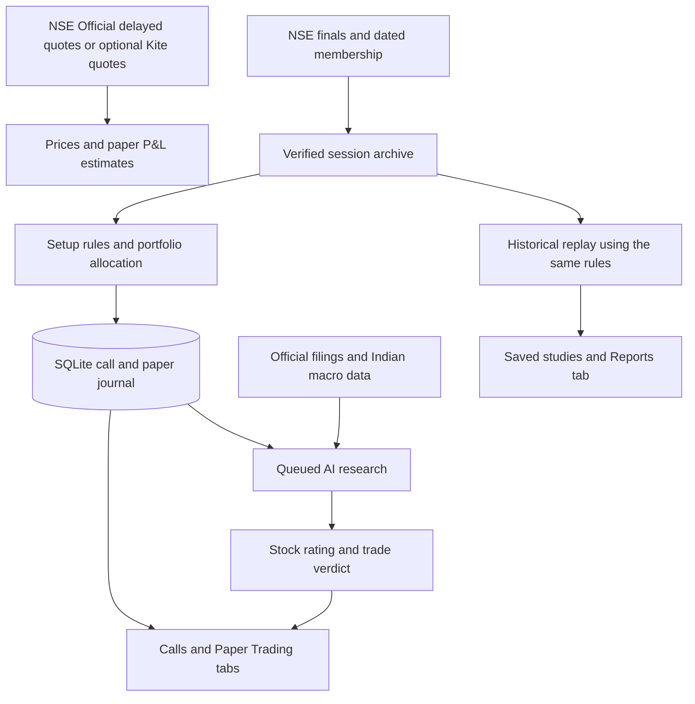

**A reading route.** Start with the four tabs and the exchange-day sequence. Follow one session through input verification, detection, allocation and paper execution. Then read how corporate actions, TradingAgents, storage and historical evaluation handle the cases that can change an outcome. The final walkthrough traces a real call and an on-demand stock report.

**Current evidence.** The latest forward scan recorded 24 setups, allocated eight to the ₹10 lakh paper account and tracked 16 separately. All eight were awaiting entry at that close. The formal historical study qualified zero strategies. The product currently simulates executions. The terminal’s broker integration reads market data. [Project overview](../README.md) · [Saved formal study](../data/backtests/research-4-c8007c0a59b4-dfcd44efeff588fa1ee2.json)

## One terminal and two clocks

Launch `uv run radar` in the project directory. Typer starts the Textual interface. A dashboard object reads local snapshots and the journal, and workers fetch quotes and advance the completed session. The optional `uv run radar run` scheduler provides unattended operation on the same data directory.

| Key | View | What changes it |
| --- | --- | --- |
| 1 | Prices | NSE Official quotes every two minutes by default, or authenticated Kite quotes every five seconds. The grid shows the exchange time in IST and labels cached quotes and dated closing prices. |
| 2 | Calls | A scan, fill, lifecycle event, research verdict or user annotation. Select Observations for forward calls, or choose a historical run. |
| 3 | Reports | A completed backtest or ranker study writes a report. Open a row to inspect windows, portfolio outcomes and qualification. |
| 4 | Paper Trading | A completed forward scan updates positions, cash and equity. Open a trade for its history, or a session for its executions. |

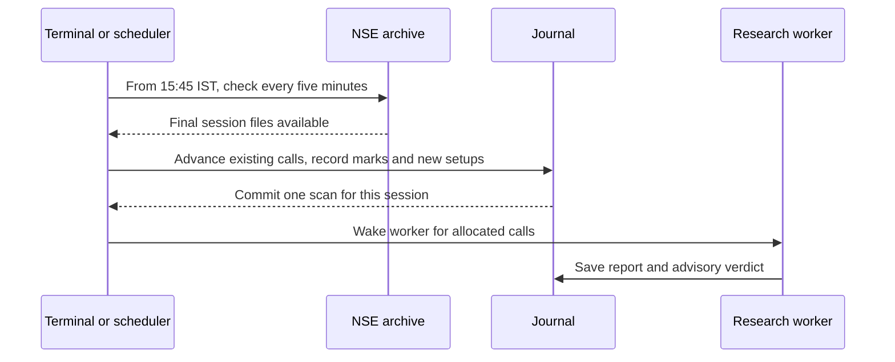

The quote display can move throughout the day. The call engine makes one decision per completed exchange session. An entry simulated at the morning open becomes visible after that session’s official file is processed. The terminal can continue showing prices while research runs. The worker can finish queued jobs after the terminal closes. Future scheduled scans require a running terminal or scheduler. [Terminal](../src/thesistally/terminal.py) · [Dashboard](../src/thesistally/dashboard.py) · [Scheduler](../src/thesistally/daemon.py)

## Dated market data and the investable universe

Each scan needs to establish which securities belonged to the index on that date, which prices were final and what restrictions were known. The business date and the security’s ISIN connect those inputs. A symbol is useful for display, while the ISIN allows the history to survive symbol changes. A documented conversion explicitly links predecessor and successor securities.

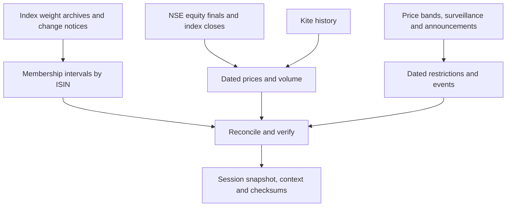

| Input | How the system uses it |
| --- | --- |
| Index membership | The public archive reconstructs inclusive intervals with symbol, ISIN, from-date, to-date and source URL. Each accepted basket is checked against official index traded shares and rounded turnover. Unresolved periods belong in a gaps report. |
| Daily bars | The forward collector uses Kite history to warm up indicators, then replaces the completed session’s prices and volume with the NSE final. Historical replay builds point-in-time adjusted bars from the exchange archive and checks available Kite history separately. |
| Exchange controls | Surveillance, price bands, known results dates and corporate actions affect eligibility or execution. A data quarantine or unknown surveillance status can send a setup to shadow. An unavailable opening band prevents an assumed entry. |

**Why reconciliation matters.** On 20 November, the snapshot records differences between 190 latest Kite equity closes and the exchange final. All 200 final equity closes reconciled. The membership audit records 3,190 verified sessions from January 2014 through November 2026 and an empty membership-gap register for that interval. Some historical surveillance and price-band coverage still has gaps. [Session manifest](../data/sessions/2026-11-20/manifest.json) · [Membership audit](../data/universes/membership-gaps.json) · [Historical data design](historical-research.md)

## Signal generation at the close

The scanner computes exponential moving averages (EMA), average true range (ATR), turnover and relative strength from completed bars. It requires at least ₹5 crore median daily turnover over 20 sessions. The three detectors can identify different setups on the same stock. Each candidate carries its ISIN, strategy, session, proposed levels and a snapshot of the inputs used.

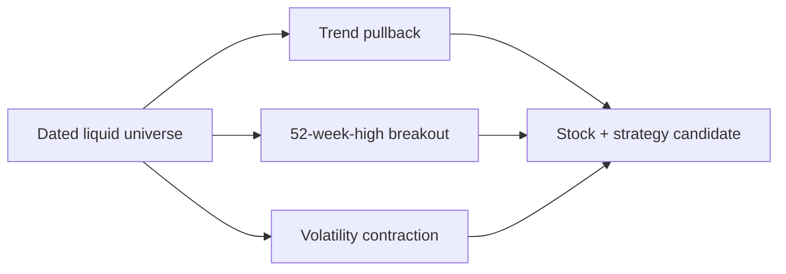

| Setup | Trigger | Initial stop |
| --- | --- | --- |
| Trend pullback | Close above the 50 EMA, and the 50 EMA above the 200 EMA. The previous low came within one ATR of the 20 EMA. Today closes above the previous high. | Lower of the latest two lows. |
| 52-week-high momentum | Relative-strength percentile at least 80 on 126-session returns. A 15–40 session base holds within 5% of the prior 252-session high. Today closes above the base high on at least 1.5 times average base volume. | Lowest low in the base. |
| Volatility contraction breakout | Two to four successive five-session blocks show narrower percentage ranges and lower average volumes. The close exceeds the pattern high on at least 1.5 times pattern volume. | Lowest low in the last block. |

**From pattern to plan.** The signal-day close is the reference entry. Planned risk per share equals entry minus stop. Target equals entry plus twice that risk. The stop must be positive and below entry. Under the current rules, a stop outside 3%–10% of entry, or farther than 2.5 ATR, excludes the setup from portfolio allocation. The scan saves a revision for each call so its plan can be reproduced as the rules evolve. [Indicators and detectors](../src/thesistally/signals.py) · [Current rule settings](../src/thesistally/rules.yaml)

## Ranking and capital allocation

The allocator first processes existing positions and values the account. It orders new candidates by relative strength, checks eligibility and reserves the available capital and risk. This order matters when two stocks compete for the last portfolio slot.

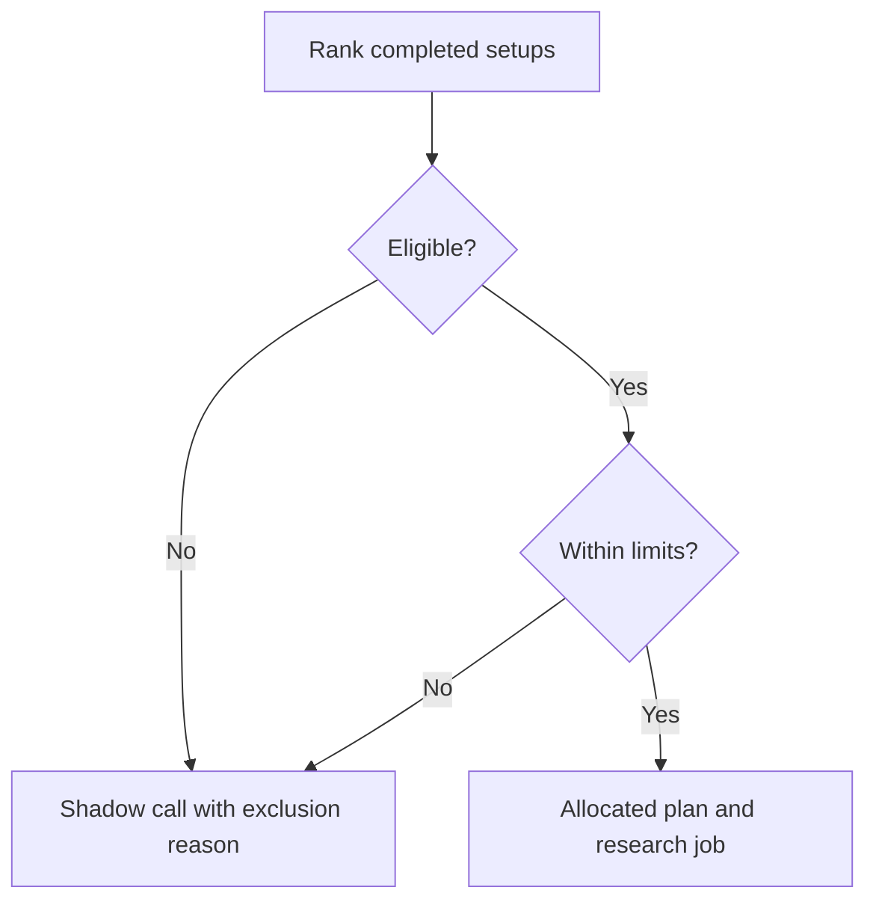

| Control | Default forward rule |
| --- | --- |
| Market conditions | Nifty 50 above its 200 EMA, at least half of eligible members above their 50 EMA, and India VIX at or below 22. |
| Security eligibility | Check price quality, stop bounds, surveillance and results coverage. The default results blackout excludes an upcoming results event within five calendar days. |
| Capital and size | Starting equity ₹10 lakh. Budget 0.5% of marked equity at risk per new trade. Divide that budget by planned per-share risk and round down, then cap by available cash, entry costs and remaining portfolio risk. |
| Concentration and drawdown | Up to eight positions, two per sector, one per ISIN, and 4% total open risk. At 6% drawdown halve new risk. At 10% pause new allocations. Ten consecutive passing regime closes restore half risk. A new equity high restores full risk. |

**Two meanings of shadow.** A *shadow call* is a detected setup tracked independently outside the funded paper account, with its exclusion reason. *Shadow AI research* is an advisory opinion on a plan. A funded plan can have a shadow AI verdict. The 20 November journal contains eight funded plans and 16 position-limit exclusions. Its calls retain their original `mvp-2` revision. New default scans use r2. Each pre-existing call retains its saved execution revision. [Portfolio allocation](../src/thesistally/journal.py) · [Ranking](../src/thesistally/ranking.py) · [Archived rule revision](../src/thesistally/revisions/mvp-2.yaml)

## Execution and the life of a call

A confirmed call is a plan waiting for the next open. The simulator uses completed daily bars and five basis points of modeled slippage per side. Its event trail preserves both the original target and the actual execution price.

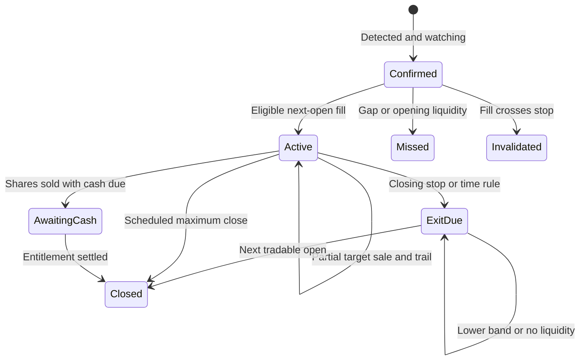

**Entry.** The modeled buy is the next open plus slippage. Opening liquidity and the upper price band must allow entry. A raw open at or below the stop invalidates the plan. An open more than half a signal ATR above the close misses. The slipped fill must keep the original stop 3–10% from entry and within 2.5 ATR. The actual target is two risk units above the fill. A later intraday touch of the planned entry does not reopen it.

**While held.** A daily high reaching target takes off half the original quantity, rounded down, or closes a single-share position. The remainder trails the higher of the existing stop, 20 EMA and 10-session low. If a daily bar reaches both the outstanding target and the stop, the engine records the stop first and schedules a full sale at the next tradable open with slippage. On a stop-only bar the closing price determines whether a sale is due.

**Exit.** A close at or below the applicable stop queues a sale at the next tradable open. Ten sessions without reaching 1R of favourable excursion trigger a time exit. The maximum holding period is 20 sessions, normally exiting at that close if executable. A locked lower band can defer execution. In the diagram, *ExitDue* represents a pending-exit field and event on an active call. A funded call with an unresolved valuation can stop the account’s advance. [Fill and exit engine](../src/thesistally/journal.py) · [Execution regression tests](../tests/test_research.py)

## Paper account and daily valuation

The funded view in Paper Trading reads the funded portion of the forward Observations run. A single journal transaction records fills and marks as the session advances. Each fill carries a side, quantity, modeled price and delivery fees. The cost model includes transaction taxes, exchange and regulatory charges, buy-side stamp duty and a sell-side depository charge. Both the Calls tab and the Paper Trading tab therefore refer to the same call ID and the same executions. A user can mark a call Taken or Skipped without changing the automatic paper account.

Press **V** in Paper Trading to compare both entry rules for every new forward signal, including portfolio exclusions. The shadow skips raw opens strictly above signal close + 0.5 × signal ATR(14). An accepted opening fill sets the target to fill + 2 × (fill − original stop). Each leg retains its fills, events and realized net R. The funded balance uses the call’s saved revision. New r2 calls also check stop distance at the actual fill. Symbols still open in either leg continue to receive daily bars.

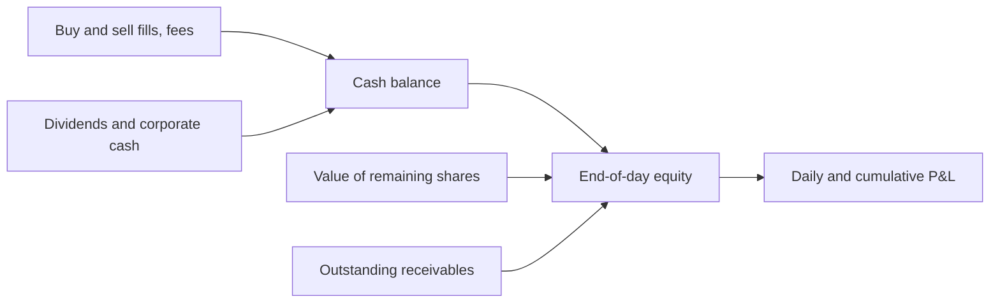

| Measure | How to read it |
| --- | --- |
| Cash | Starting capital less purchases and fees, plus sales and cash receipts. Reserving capacity for a pending call leaves its unspent cash on the account statement. |
| Holdings | Remaining shares valued at the completed session’s close. A suspended position follows the frozen-value convention. |
| Equity and daily P&L | Equity equals cash plus holdings plus outstanding corporate receivables. Daily P&L is the change from the previous equity mark. Total P&L is the difference from starting capital. |
| Per-trade P&L | A daily position mark combines remaining position value with cash flows, fees and entitlements attributable to that call. Closed calls show net realised rupees and R. Realised R uses the original filled risk and size. |

**What the operator sees.** The trade list distinguishes awaiting entry, open, exit pending, missed and closed calls. The daily table shows cash, holdings, equity and changes in rupees. Selecting a date shows that session’s fills. Older journals can establish starting equity before the first fill. If a later legacy valuation cannot be established, the terminal shows a dash.

**As of the 20 November close**, the account had ₹10,00,000 in cash and equity, eight plans awaiting entry, zero positions and ₹0 P&L. Shadow calls and historical replay accounts are isolated from these balances. [Paper account queries](../src/thesistally/paper.py) · [Four-session accounting test](../tests/test_paper.py)

## Corporate actions and untradeable periods

The simulator follows the held security even after it leaves the index. A documented compulsory conversion can change its ISIN, share count and price scale. The journal keeps the original plan and carries an effective successor position for valuation and execution.

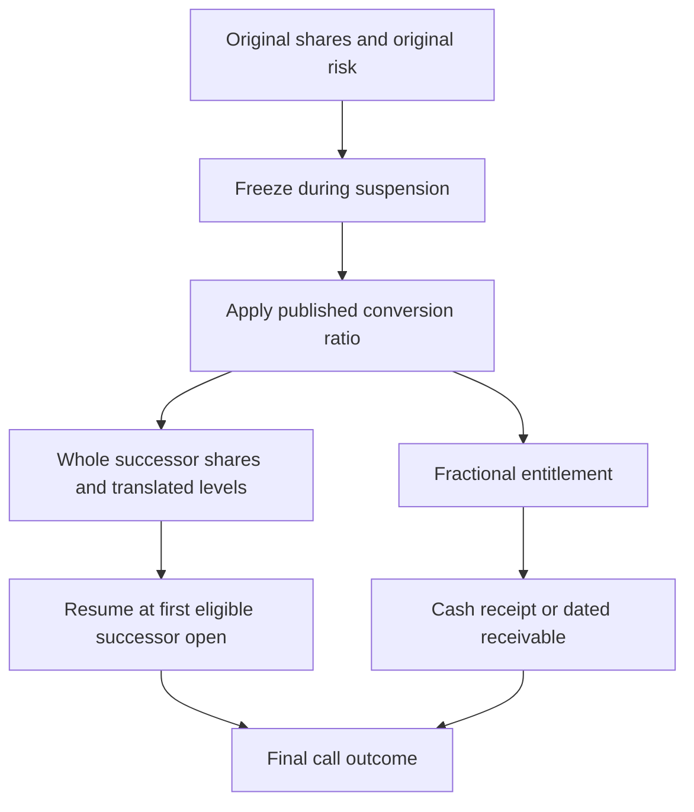

**Worked conversion.** The Tata Motors DVR replay held 209 shares. A 7-for-10 conversion yielded 146 whole ordinary shares and a 0.3-share fractional entitlement. A predecessor stop of ₹700 translates to ₹1,000 per successor share. The archive records suspension on 30 August 2024, effectiveness on 1 September and credit confirmation on 25 September. The chosen first eligible successor open was 26 September.

**Settlement.** During the freeze the model carries the last tradable value. A stop or time-exit breach during the freeze can queue an exit for the first eligible successor open, with slippage. Fractional proceeds use the issuer’s published sale price when available. The fallback uses the first observed successor trading close and flags it. If cash is due after an exit, the call can remain in `awaiting_cash` until settlement.

**Other cases and audit.** A cash delisting uses the official exit offer or a flagged last-traded-price fallback. Events store the convention version, source, dates, ratio and cash. Investor-specific withholding is a note under the gross, pre-tax convention. Sensitivity checks show the effect of zero fractional proceeds and of excluding affected calls with other fills held fixed. [Settlement implementation](../src/thesistally/corporate.py) · [Action register](../src/thesistally/revisions/compulsory-actions.json) · [Historical convention and issuer sources](historical-research.md)

## TradingAgents research and the two decisions

TradingAgents 0.2.5 runs automatically for newly allocated forward calls. A symbol or a call ID can also start a report on demand. The default provider launches the signed-in Codex CLI in a temporary read-only workspace. The application sends the dated evidence to the configured model provider. The Codex subprocess receives it on standard input, with external tools disabled and instructions to treat filing text as data. A single model serves the different analyst and debate roles.

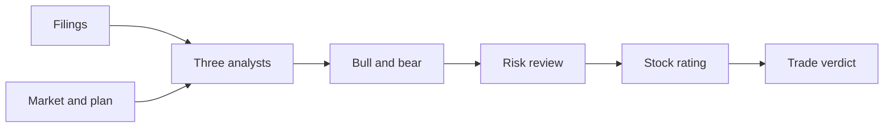

**Evidence.** The collector looks back 100 calendar days for official NSE and BSE disclosures, using a 15:45 filing cutoff on the report date. It reads results, announcements, presentations, transcripts and shareholding filings where available. PDF text and XBRL sections supply quotes, locations, source URLs and hashes. The market packet includes up to 60 sessions of prices, sector and benchmark comparisons, India VIX and available RBI and institutional-flow observations.

**Outputs.** The research manager weighs the bull and bear cases. A trader proposes a stance, followed by a risk debate and portfolio-manager review. The stock rating ranges from Strong Sell through Hold to Strong Buy. The trade verdict evaluates the existing entry, stop, target and size. Each has written reasons and confidence from 1 to 5. Confidence is a qualitative assessment. Financial tools receive the available filing extracts. Missing valuations, incomplete scanned pages or unavailable feeds limit what an analyst can conclude.

**Influence on the account.** By default the verdict is advisory. Enforcing a veto requires explicit configuration, at least 100 comparable closed forward calls with pre-entry verdicts, at least one veto and improved mean R when vetoes are excluded. A qualifying veto can move a pending allocation to shadow. The app records provider, model, tokens, prompt version, evidence provenance and status. Codex uses the signed-in allowance. A separately configured OpenAI API provider uses a metered budget. [Research graph](../src/thesistally/research.py) · [Codex adapter](../src/thesistally/codex_research.py) · [Verdict audit](../src/thesistally/research_journal.py)

## Persistence and reproducibility

The default data directory is `data/`. SQLite owns journal state. Dated files preserve exchange inputs and larger outputs, including Parquet prices, original filings and JSON studies. The project can point to another data directory using `RADAR_DATA`.

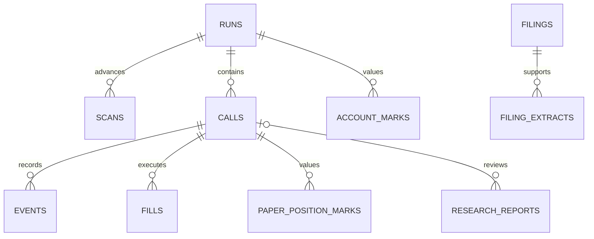

| Storage | Contents and identity |
| --- | --- |
| `sessions/`, `context/`, `universes/`, `sources/` | Session manifests, exchange files, membership intervals, coverage, controls and prices. Dates, ISINs and checksums identify inputs. |
| `journal.sqlite` | Runs, scans, calls, event history, fills, cash entitlements, corporate positions, daily account and per-position marks. A call is unique within run, detection day, ISIN and strategy. |
| `filings/`, `macro/`, `research/` | Original dated documents, macro snapshots and per-symbol machine-readable reports. SQLite links filing extracts, AI requests, report metadata and verdicts. An on-demand symbol report can have a null call ID. |
| `backtests/`, `rankers/`, `provenance/` | Sealed study output, ranker comparisons or models, and source fingerprints. Reports retain parameters and rule, data and code identifiers for reproduction. |

**Commit and recovery.** Each run/day has one scan record. The journal advances calls, records events, marks the account, allocates new plans and enqueues forward work within a SQLite transaction. Rerunning a committed day preserves its existing calls and fills. Forward catch-up walks verified predecessor sessions in order. Session collection stages files before publishing. The worker serialises queue draining per data directory, and interrupted running jobs can be picked up at restart. [Journal schema and transaction](../src/thesistally/journal.py) · [Research worker](../src/thesistally/research_worker.py) · [Source provenance](../src/thesistally/provenance.py)

## Historical evaluation and model qualification

Historical replay uses the same detector, ranking, portfolio and execution functions as forward observation. Each evaluation window starts with a fresh account. The study measures whether the rules survive different markets, and whether a learned ranking improves the allocation of scarce slots.

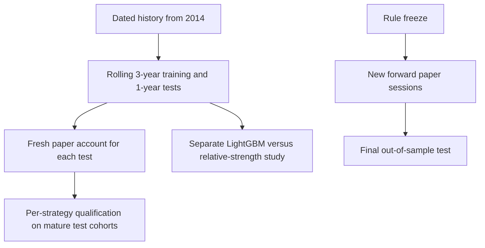

**Evaluation design.** The sealed `research-4` study completed nine test windows and a separate 375-session holdout from 21 May 2025 to 20 November 2026. The holdout ledger records consumption by revision. Test windows compare the default five-calendar-day earnings exclusion with a holding-period alternative. Outputs include after-cost R, rupee P&L, cash profit factor, drawdown, exposure and returns alongside the Nifty 200.

**Qualification gates.** Each strategy needs at least 100 closed out-of-sample calls and at least 20 per test window. Mean R must exceed 0.25, the lower bound of the 90% bootstrap interval must exceed zero, and cash profit factor must exceed 1.4. At least two thirds of windows must be positive, including one in which weak-market sessions are the majority. Mature test cohorts determine qualification. The archived r1 study reported its historical holdout separately. The r2 final test begins after the rule freeze.

**Measured result.** The holdout closed 74 simulated portfolio trades, with −0.270R mean, 0.56 profit factor and approximately ₹69,427 realised net loss. No strategy qualified. The original 35-session diagnostic had only five closed holdout trades and +0.134R mean. Both historical results remain available for comparison with their original rule revisions.

**Ranking experiment.** LightGBM uses detection-time features and a label indicating whether the call reached 2R of favourable excursion. A 20-session training gap limits overlap. Only one window had enough resolved examples. Relative strength closed nine trades at −0.140R mean and the model closed ten at −0.618R. Activation requires at least two comparable windows, 100 closed trades per arm and positive improvement. Relative strength remains active. [Evaluation code](../src/thesistally/evaluation.py) · [Sealed study](../data/backtests/research-4-c8007c0a59b4-dfcd44efeff588fa1ee2.json) · [Ranker comparison](../data/rankers/5ae687f2d13cc38ffd12.json)

## Operations, failures and recovery

The terminal is sufficient for market monitoring, after-close scanning, automatic AI research and paper trading. The optional scheduler adds instrument preparation, message delivery, health checks and backup. Both can share one data directory. Times below are IST and describe when jobs become eligible.

| When | Scheduler responsibility |
| --- | --- |
| 08:30 on exchange days | Check the Kite session and prepare instruments and prior-session exchange controls. The operator supplies the daily Kite login. |
| From 15:45 on exchange days | Look for the NSE final every five minutes. Collect, reconcile and advance the journal once. If earlier sessions were missed, process the verified chain in order. |
| While running | Attempt private Telegram delivery every 15 seconds and check the AI queue every 30 seconds. The terminal can also launch the detached research worker after its scan. |
| 22:45 and 23:00 | Warn about missed exchange-day jobs from 22:45. From 23:00, back up to a configured directory outside the data tree, using a consistent SQLite backup. |

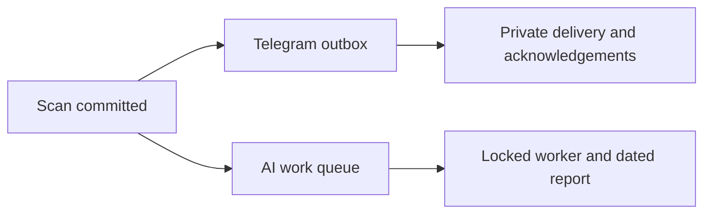

| Failure | Observable behaviour |
| --- | --- |
| Expired Kite session or missing final | Price status can fall back to cached or archived values. The scan waits for verified inputs. Missing or failed scheduler jobs retain their status for retry or warning. |
| Filing source or Codex unavailable | Record a source or research failure. The saved call and its rules-based execution can continue. Disabling research pauses queued work. |
| Telegram unavailable | Durable outbox entries retry. A crash after sending and before the local acknowledgement can duplicate a notification. Taken/Skip callbacks are checked against the configured private chat. |
| Missing funded valuation | Identify the affected security, date and call. Historical windows have independent accounts so another window can continue. |

**Operating boundary.** Credentials come from local configuration. Session manifests and report provenance contain evidence identifiers. The trading path records simulated fills in SQLite. No process in this design submits broker orders. [Scheduler and backups](../src/thesistally/daemon.py) · [Notification transport](../src/thesistally/notifier.py) · [Operator settings](operations.md)

## Component map and verification

The application is a Python package with a local event journal. The terminal and scheduled service share the same scan entry point. Historical evaluation reuses the calculation layer with its own run identifiers. A new rule or execution assumption can therefore be exercised against archived sessions before it affects future observation calls.

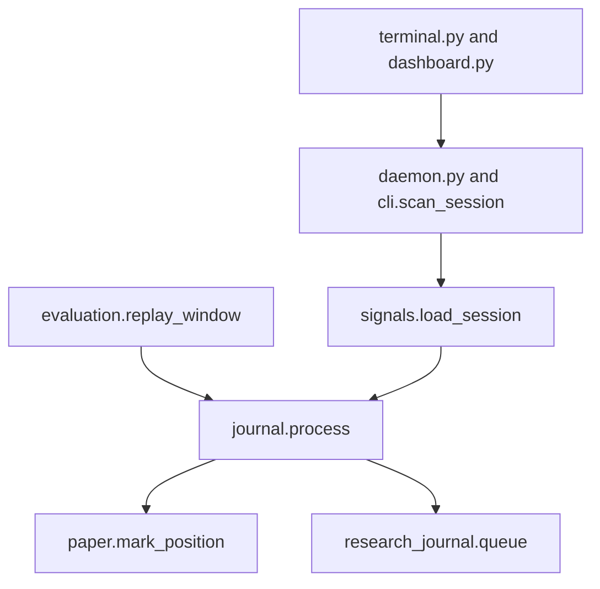

| Engineering question | Where the behaviour lives |
| --- | --- |
| Which input did a decision use? | Market and exchange collectors build the dated snapshot. The manifest identifies files and hashes. Constituents and reconstitutions build the dated universe and its coverage record. |
| Where does a strategy change go? | Rule values belong in the YAML configuration. Detectors build candidates in `signals.py`. Ranking orders them before `journal.process` applies portfolio limits. Rules and configurations have revision IDs. |
| Where is a fill or valuation explained? | `journal.advance` handles execution and exits. `corporate.settle` handles compulsory actions. The paper account reads the resulting fills, receipts and daily marks. |
| Where does a new evidence source enter? | Filing collection and section extraction precede the research graph. The provider adapter supplies model responses. The graph records cited findings, proposed explanations and verdicts. |
| How can a change be checked? | The test suite covers indicator triggers, next-open gaps, idempotent scans, paper accounting, compulsory actions, point-in-time history, evaluation gates, worker dispatch and terminal navigation. Run `uv run --frozen pytest -q` for the local suite. |

**A useful invariant for debugging.** Replaying a committed date must preserve its fills and paper balance. Changing a user annotation must preserve the simulated outcome. Adding a post-entry AI opinion must preserve the pre-entry audit sample. Each invariant has an observable journal record or a regression test. [Scan orchestration](../src/thesistally/cli.py) · [Forward journal](../src/thesistally/journal.py) · [Paper lifecycle test](../tests/test_paper.py) · [AI audit tests](../tests/test_shadow_research.py)

## Two records to follow in the terminal

The 20 November journal contains a COFORGE setup and an SBI company review. They illustrate why a call, a fill and a report have distinct identities.

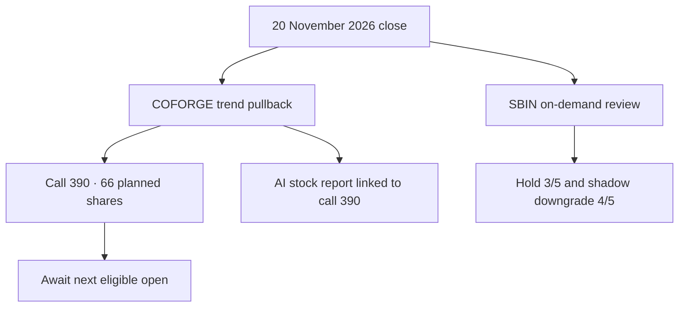

**COFORGE.** The signal-day close was ₹2,086.70 and the pattern stop was ₹2,011.20. Planned risk was ₹75.50 per share. Twice that risk gave a target of ₹2,237.70. The model sized 66 shares, representing ₹4,983 of planned risk before execution. A reservation preserved portfolio capacity while cash remained unspent. The Calls tab shows the evidence and the linked Hold rating. The Paper Trading tab shows the same call awaiting entry.

**State Bank of India.** SBI generated zero rule-based setups that day. Its on-demand report reviewed 38 exchange filing records. It weighed 14.69% growth in net interest income against a roughly 1.4% decline in operating profit after adjusting both quarters for stake-sale gains. The stock rating was Hold at 3/5 confidence. The trade-risk reviewer returned Downgrade at 4/5 and identified missing entry, stop and size. The account had no SBI order to execute. The checked human-readable report also corrected a purchase price that the automated extractor missed in a scanned annexure. [SBI research and correction](../data/research/SBIN/SBIN-2026-11-20.md)

| To inspect locally | Action |
| --- | --- |
| The live terminal and account | Run `uv run radar`, then press **4** for Paper Trading or **2** for Calls. |
| The original COFORGE plan and events | Run `uv run radar call 390 --json`. |
| A new dated SBI research report | Run `uv run radar research SBIN --date 2026-11-20`. This invokes the configured research provider. |
| Research settings and paired outcomes | Run `uv run radar research-mode` and `uv run radar ai-audit --json`. |

**Coverage today.** Every eligible trading session scans the full dated universe. Full AI reviews are automatic for allocated calls and available on demand for individual stocks. A scheduled rotation of full AI reports across all 200 stocks remains a proposal. [CLI entry points](../src/thesistally/cli.py) · [Operations guide](operations.md)
